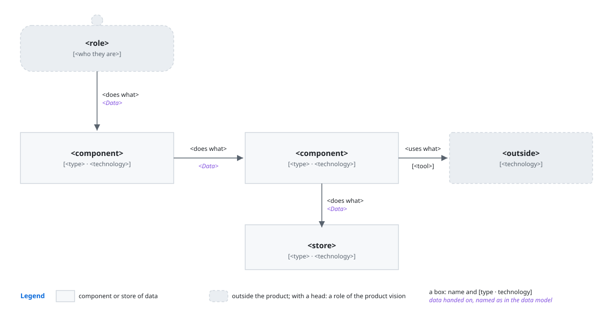
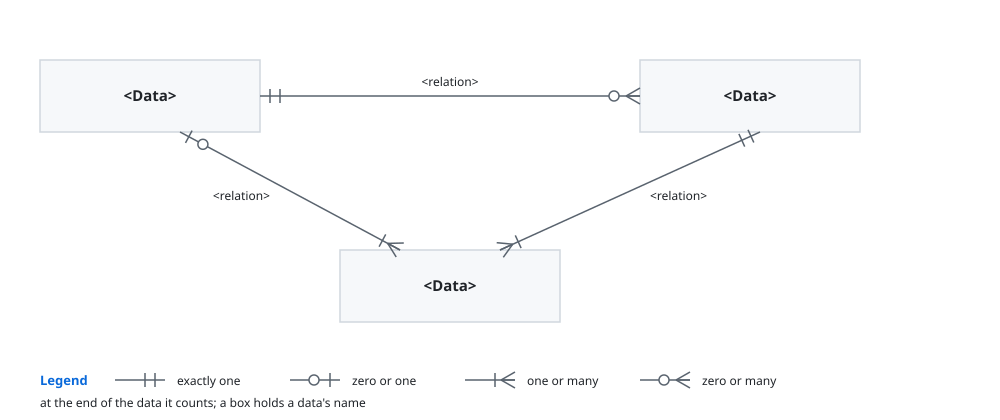
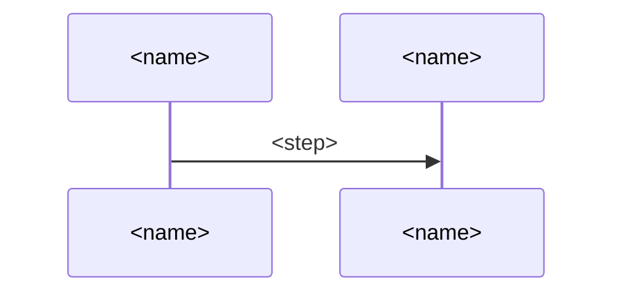
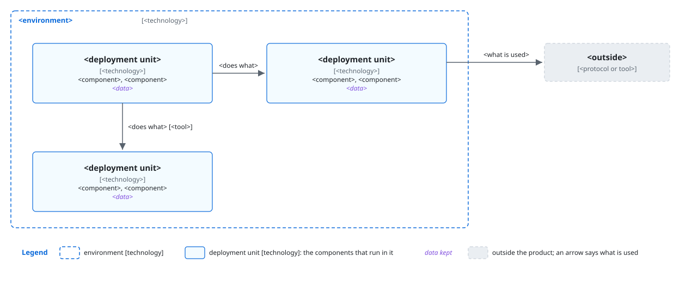
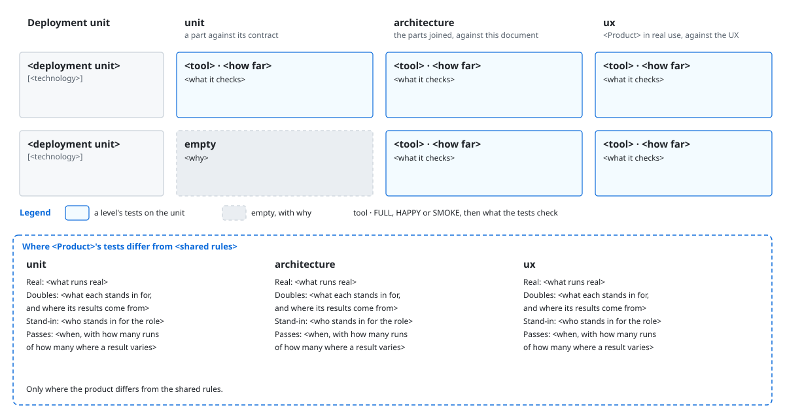

# `<Product>` architecture

This document says how `<Product>` is built to give [its product vision board](<board>). `<idea>`.

> [!NOTE]
> DELETE_TEMPLATE_COMMENT:
> - `<board>`: the path to the product's product vision board.
> - `<idea>`: how the product turns what its roles bring into what the product vision board
>   promises, as one idea seen from above that every part carries out, in a few sentences.

## Principles

`<Product>` builds on [`<other>`](<path>), and adds these.

### `<name>`

`<rule>`.

*Why*: `<why>`.

> [!NOTE]
> DELETE_TEMPLATE_COMMENT:
> - `<other>`, `<path>`: the architecture whose principles this one builds on; optional, with the
>   sentence that names it.
> - `<name>`: what the principle is found by, in a few words.
> - `<rule>`: one rule every part meeting the same decision follows, what must be absent among them.
> - `<why>`: what the rule is there for, and what goes wrong for a role of the product vision board
>   or the developer without it.

## User stories

- **`S<n>`**: As `<role>`, I want `<way>`. Carries `<steps>`.

> [!NOTE]
> DELETE_TEMPLATE_COMMENT:
> - `<role>`: a role of the product vision board, as the product vision board names it.
> - `<way>`: one way the role meets the product at its edge, such as a command they type.
> - `<steps>`: the steps of the product vision board's scenarios that rest on it, and each
>   convenience the product vision board's intent asks for that it carries, such as resuming a run
>   that stopped.

## Components



- **`<choice>`** over `<other way>`: `<why>`. It costs `<cost>`.

> [!NOTE]
> DELETE_TEMPLATE_COMMENT:
> - The figure: the deliverable's own at images/components.svg, the product named in its alt text:
>   each role the stories need and each store of data, each box holding its name, its type and
>   technology, and what it alone decides; each arrow what one does to another, with the data it
>   hands on, named as in the data model; a legend for every symbol.
> - `<choice>`, `<other way>`: each choice a developer would question, such as a technology or a
>   tool, and the way it beat; optional.
> - `<why>`, `<cost>`: what the choice gives, and what it costs.

## Data model



> [!NOTE]
> DELETE_TEMPLATE_COMMENT:
> - The figure: the deliverable's own at images/data-model.svg, the product named in its alt text:
>   each data the components pass or keep, by its name and what it is in a few words, without its
>   fields, and each relation between two data, with its name and how many of each it joins at both
>   ends.

## Sequences

### `S<n>`: `<path>`



- **`<choice>`** over `<other way>`: `<why>`. It costs `<cost>`.

> [!NOTE]
> DELETE_TEMPLATE_COMMENT:
> - One section for each user story; stories that share their steps share a section.
> - `<path>`: what the story does, in a few words.
> - `A`, `B`: a short id for each one that takes part, used in the messages.
> - `<name>`: the role of the story, each component it reaches, as Components names it, and each
>   thing outside the product it reaches.
> - `<step>`: what one does to another and the data it hands on, as the data model names it, in a
>   few words; each branch, each step that sends work back and each question put to the role among
>   them.
> - `<choice>`, `<other way>`, `<why>`, `<cost>`: as in Components; optional.

## Deployment



`<start>`.

- **`<choice>`** over `<other way>`: `<why>`. It costs `<cost>`.

> [!NOTE]
> DELETE_TEMPLATE_COMMENT:
> - The figure: the deliverable's own at images/deployment.svg, the product named in its alt text:
>   each environment the product runs in, such as the user's computer or CI, with its technology; in
>   each, its deployment units, each with its technology and the components and data it holds, by
>   their names in Components; each thing outside the product the components depend on, with what
>   they use of it.
> - `<start>`: how the product starts, in one sentence.
> - `<choice>`, `<other way>`, `<why>`, `<cost>`: as in Components; optional.

## Directory structure

```text
<path>  <holds>
```

- **`<choice>`** over `<other way>`: `<why>`. It costs `<cost>`.

> [!NOTE]
> DELETE_TEMPLATE_COMMENT:
> - `<path>`: each folder and file that holds a component or a data, nested as on disk, without the
>   files inside a component.
> - `<holds>`: the component or the data it holds, as Components names it.
> - `<choice>`, `<other way>`, `<why>`, `<cost>`: as in Components; optional.

## Tests

`<Product>` tests by [`<shared rules>`](<path>), and differs from them where this section says.



- **`<choice>`** over `<other way>`: `<why>`. It costs `<cost>`.

> [!NOTE]
> DELETE_TEMPLATE_COMMENT:
> - `<shared rules>`, `<path>`: the project's shared test rules.
> - The figure: the deliverable's own at images/tests.svg, the product named in its alt text: a
>   table with a row for each deployment unit, by its name in Deployment, and a column for each test
>   level from narrow to wide, each named by what it checks against: unit, a part's contract;
>   architecture, this document; ux, the product vision board. Each cell holds the tool, a weight,
>   such as ●●○, and what it checks in a few words; an empty cell says why. Under it, for each
>   level: what runs real, what doubles stand in for and where their results come from, who stands
>   in for the role, and when it passes, with how many runs of how many where a result varies; only
>   where the product differs from the shared rules.
> - `<choice>`, `<other way>`, `<why>`, `<cost>`: as in Components; optional.
