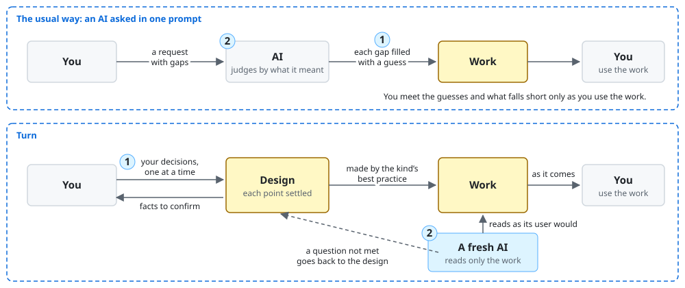
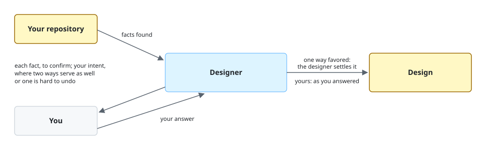
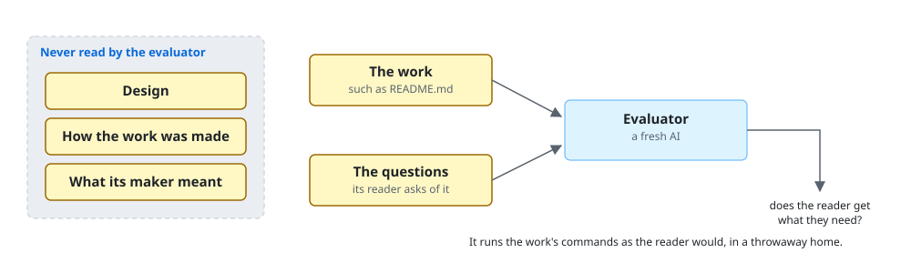
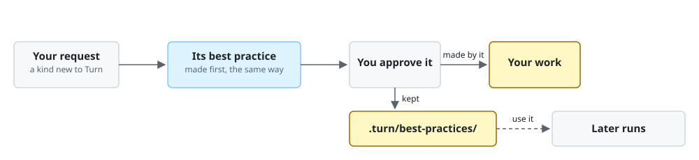

# Turn

Turn is a Claude Code plugin that makes the document or code you ask for, such as a README, so
that the people it is for get what they are after from it.

Turn 0.1.0 is still in development and not yet released: a run may stop on a fault of Turn's own,
and the walkthrough below shows the run Turn is built for, not yet a recorded one.

Turn is for you when you want an AI to make a document or code that serves the people it is for,
not a draft you fix yourself. With it, you hand them work they can use for what they are after, as
it is.

**Non-goals**

- Turn does not commit, push or publish the work.
- Turn does not settle your purpose or your intent. A point you leave unanswered holds the run.
- Turn is not for a quick draft you will fix yourself: it takes longer than asking Claude Code.

## Requirements

- Claude Code 2.1.317 or later: `claude --version` shows it.
- Python 3.9 or later, run as `python3`: `python3 --version` shows it.

## Installation

```console
claude plugin marketplace add lovaizu/ccpm
claude plugin install turn@ccpm
```

`claude plugin list` then lists `turn@ccpm`, and `pin@ccpm`, which comes with it.

## Walkthrough

At the end, you have a README for your tool `tidy`, as Turn hands it over, with which someone
with a cluttered Downloads folder installs tidy and sorts their folder.

`tidy` sorts a Downloads folder into folders by type, and its repository has no README. At its
root, in Claude Code, you type:

```text
/turn:up a README for tidy
```

Turn shows:

```text
Purpose: someone with a cluttered Downloads folder learns what tidy does, installs it and
sorts their folder with it. Yes?
```

You answer `yes`. Turn shows:

```text
Found: tidy/cli.py:22 adds --dry-run, so tidy can show what it would move without moving it.
Right?
```

You answer `right`. Turn shows:

```text
Intent: the reader should see what tidy would move before it moves anything, so the walkthrough
runs tidy --dry-run first. Yes?
```

You answer `yes`. Turn shows:

```text
Design: ...
- The walkthrough runs tidy --dry-run, then tidy, on five files.   (you)
- Requirements: Python 3.9 or later.                               (found in setup.cfg)
Approve?
```

You answer `yes`. Turn shows:

```text
Done: README.md is written, not committed. Its reader gets all a README's reader needs.
```

## How it works



1. **The AI starts from scratch and writes what similar texts say, not what your reader needs.**
   Turn makes each kind of work by its best practice, which holds the goal the work's reader
   reaches, a template of what the work holds and the questions its reader asks of it.
2. **Its review gives many findings, few that matter.** A fresh AI, the evaluator, asks only
   those questions, whether the work's reader gets what they need, so each shortfall it finds
   matters.
3. **It fills what you did not say with guesses.** Turn finds each fact in your repository and
   asks you to confirm it, and asks you your purpose and intent, one point at a time, so nothing in
   the work is a guess you never saw.
4. **You find what falls short only as you use the work.** The evaluator tries the work as its
   reader would, running its commands in a throwaway copy of your repository, so the work reaches
   you only once it works in use.
5. **Each fix is added on, and the work gets noisier.** A question not met goes back to its
   decision, and the work is made again from the design, the record of every fact and decision, so
   no fix sits beside it.



**How does Turn tell what to ask you?** Its designer finds what your repository holds and shows it to you
to confirm. It settles a decision that the purpose, the facts and your answers favor, and asks you
only your intent: where another way would serve as well, or would be hard to undo. It writes each
into the design with who settled it.



**How can an AI judge an AI's work?** The evaluator is a fresh AI that gets only the work and the
questions of its kind, never the design, so it judges by what the work's reader gets, not by what
its maker meant.



**What if Turn has no best practice for your kind of work?** Turn first makes one, the same way it
makes any work, and you approve it. It is kept in `.turn/best-practices/`, so later runs in your
repository use it.

## Documentation

- [Calling Turn](../../../../docs/calling.md): for an AI that asks Turn for a document or code on a person's behalf.
- [Changelog](../../../../CHANGELOG.md): the changes in each version.
- [Issues](https://github.com/lovaizu/ccpm/issues): where you ask for help or report a fault.

## License

[MIT License](../../../../../../LICENSE)
