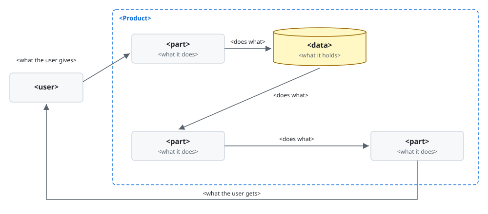

# `<Product>`

`<Product>` is `<kind>` that `<what it does>`.

`<status>`.

`<Product>` is for you when `<your situation>`. With it, you `<gain>`.

**Non-goals**

- `<Product>` does not `<expectation>`.

> [!NOTE]
> DELETE_TEMPLATE_COMMENT:
> - `<kind>`: the kind of thing the product is, such as a command-line tool.
> - `<what it does>`: what the product does, in words the reader already uses.
> - `<status>`: where the product is not yet fit for use, such as a release still in development;
>   optional.
> - `<your situation>`: the work the reader wants done.
> - `<gain>`: what the reader can then do.
> - `<expectation>`: each thing a reader might expect of the product that it does not do; optional.

## Requirements

- `<requirement>`: `<check>` shows it.

> [!NOTE]
> DELETE_TEMPLATE_COMMENT:
> - `<requirement>`: each thing that must be in place before installing.
> - `<check>`: a command whose output tells the reader they have it.

## Installation

```console
<command>
```

`<sign>`.

> [!NOTE]
> DELETE_TEMPLATE_COMMENT:
> - `<command>`: each command that installs the product.
> - `<sign>`: what tells the reader that the installation worked.

## Walkthrough

At the end, you have `<result>`.

`<situation>`. You type:

```<language>
<input>
```

`<Product>` shows:

```<language>
<output>
```

> [!NOTE]
> DELETE_TEMPLATE_COMMENT:
> - `<result>`: what the reader has once the run ends.
> - `<situation>`: what the run starts from, in one sentence.
> - `<input>`, `<output>`: what the user gave and what the product showed in a real run, as they
>   were, in the form the reader meets them; one pair for each exchange up to the result.
> - `<language>`: the language of the text, such as console, python or json. A screen goes in place
>   of its code block, as an image taken from the run and kept in images/.

## How it works

`<problem>`



`<how it removes it>`

[`<title>`](<path>)

> [!NOTE]
> DELETE_TEMPLATE_COMMENT:
> - `<problem>`: what the reader is left with the way they would do the work without the product,
>   in one or two sentences.
> - The figure: one for each place where that way leaves the problem unsolved, or for several that
>   one picture shows together, at images/`<name>`.svg, the product named in its alt text: a
>   measure, such as a benchmark, where the edge is measured; the same work done both ways where one
>   example shows it; or, as the skeleton here, the user, the product's parts and what they pass,
>   each by its name, where the edge lies in the design.
> - `<how it removes it>`: under each figure, how what it shows removes that part of the problem, in
>   one or two sentences.
> - `<title>`, `<path>`: the page that explains it further, where it needs a long sequence of
>   figures; optional.

## Documentation

- [`<title>`](<path>): `<what it gives>`.

> [!NOTE]
> DELETE_TEMPLATE_COMMENT:
> - `<title>`, `<path>`: each document a reader goes to next, by a path relative to the README, and
>   the place they get help, such as an issue tracker, by its URL; optional.
> - `<what it gives>`: for whom the document or the place is and what it gives them.

## License

[`<license>`](<path>)

> [!NOTE]
> DELETE_TEMPLATE_COMMENT:
> - `<license>`: the name of the license.
> - `<path>`: the license's full text.
