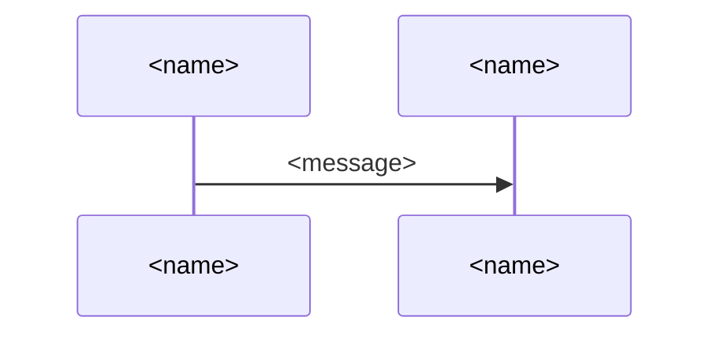

# `<Product>` UX

## Roles

- **`<role>`**: `<who they are>`.

> [!NOTE]
> DELETE_TEMPLATE_COMMENT:
> - `<role>`: each role that comes to the product with a want of its own, such as a guest, a member
>   or an admin; "user" where it is the only one.
> - `<who they are>`: in one clause.

## OKRs

- `O<n>`: `<objective>`
  - `KR<n>.1`: `<key result>`. `<direction>`.
  - `KR<n>.2`: `<key result>`. `<direction>`.

`KR<n>.1` comes first: a change that improves `KR<n>.2` is kept only if `KR<n>.1` does not get
worse.
Key results have no targets, as a measure made a target stops being a good measure (Goodhart's
law). They show whether a change brought its objective closer.

> [!NOTE]
> DELETE_TEMPLATE_COMMENT:
> - `<objective>`: what one role of Roles wants, in one sentence.
> - `<key result>`: what is measured, in one sentence.
> - `<direction>`: which way is better, such as "Lower is better".

## Product

`<Product>` instead of `<present way>`:

- **`<idea>`**: `<why it meets the objective>` (`O<n>`).

> [!NOTE]
> DELETE_TEMPLATE_COMMENT:
> - `<present way>`: what the roles do today without the product, such as doing the work by hand.
> - `<idea>`: each idea that sets the product apart from the present way, at most five, each in a
>   few words.
> - `<why it meets the objective>`: why the idea meets the objective where the present way falls
>   short, in one sentence, from what the role does, sees or receives.

## Scenarios

### `O<n>`: `<path>`

> [!NOTE]
> DELETE_TEMPLATE_COMMENT:
> - One section for each objective.
> - `<path>`: how the role reaches `O<n>`, in a few words.
> - `A`, `B`: a short id for each one that takes part, used in the messages.
> - `<name>`: each one that takes part: a role as Roles names it, the product, or one outside it,
>   such as a payment service.
> - `<message>`: what one asks or hands another, in a few words.
