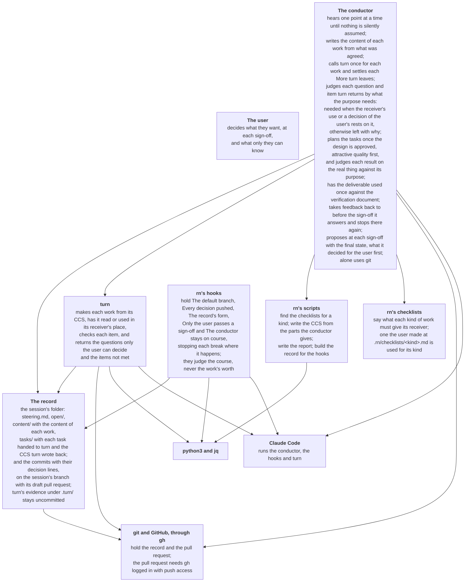

# rn design

rn keeps what its [README](../README.md) promises by one split: the conductor, the conversation
with the user, decides everything, and turn, the plugin rn is built on, makes everything. For each
work, one thing made for one purpose, one file or several, the conductor writes the content, what
the work must say or do item by item of its checklists, from what was agreed with the user, and
hands turn one task for it in a CCS, the JSON file that carries the task to turn and turn's result
back. turn makes the work, has it read or used by an AI that did not make it, as the person it is
for would, and checks each item. At each sign-off, a point where the user looks at the work before
it goes past and approves with `/rn:ty` or gives feedback with `/rn:gm`, the conductor puts to the
user a proposal, which the user decides the sign-off from. So nothing reaches the user that was not
read in its receiver's place, and the user is asked nothing the conductor could look up.

How to use rn is in its README; what turn does with a task is in
[turn's design](../../dev/turn/design.md), and how a caller hands it one is on
[turn's callers' page](../../turn/calling-from-a-plugin.md); what each kind of work must give is in
[rn's checklists](../checklists/). A statement no trial has checked yet is marked "(assumption)".

## Goals

### Attractive quality

- What they really want from rough words: what the user gets is what they meant.

  rn asks why the user wants the goal and what the result should do for them, one point at a
  time, looks up what the repository and the documentation can tell, and offers ways only after
  the user has said what they want, each with what it gives and costs and the one it recommends.

- Called only for decisions that are theirs: the user is asked only what the goal, the
  repository, the documentation and best practice cannot settle.

  Between sign-offs they never watch the work.

- Decided from the proposal alone: at a sign-off the user says yes or no without reading the work
  over.

  The proposal shows how close the work has come to each thing they would choose it for, what
  changed since their last approval, what rn decided for them, and each item met with where.

- Goes on from where it stopped: tomorrow, or a fresh conversation, takes up the session without
  the user explaining anything again.

  A session is one goal carried through to the end, on its own branch with a draft pull request.
  It is taken up from its record: its folder `.rn/{yyyymmdd}-{slug}/` and the commits on its
  branch.

- Read in its receiver's place before the user sees it: every work is read or used by an AI that
  did not make it, as its receiver would, and checked item by item.

  The works are the plan, `steering.md`, the three documents of the design, each task's result and
  each proposal. The plan's acceptance criteria are attractive ones, what would make the user
  choose the result, `A1`..., and must-be ones, what they take for granted, `M1`...; each task,
  check and judgment refers to a criterion by its ID.

  On each item of a work's checklists, turn finds a Good, what the user gains, which a fix must
  not take away, or leaves a More, what the user will struggle with. The conductor finishes a
  small More itself; where fixing a More would change the content much, turn makes the work again
  from the changed content; and a fatal More, one without whose fix the goal cannot be achieved
  and whose fix only the user can decide, is put to the user in the proposal. So no More reaches
  the user unsettled except as a decision of theirs.

### One-dimensional quality

Each must be no worse than in the version in use, the version users run now, which each trial's
record names.

- Questions answered: the fewer questions the user answers in a session beyond the sign-offs, the
  better.

  Each one beyond what only they could decide is time they spend on what rn could have settled.

- Time and tokens to each sign-off: the less a session takes from its start to each sign-off, the
  better.
- What the user reads at a sign-off: the shorter the proposal, the better.

  It grows only with what the user decides, not with the work checked.

### Must-be quality

- The default branch: it changes only when the user merges.
- Every decision pushed: every decision is committed and pushed as it is made, with a decision
  line, and every settled item of `open/` is whole in the commit that settles it.

  The decision line is the last line of every commit the conductor makes,
  `● {#id task name | plan | design | deliverable} ── {what was decided} → {next move}`; the one
  on the branch's last commit is where the session stands.

  `open/` holds what is not yet settled, one file per item, of three kinds: a `report` on a work,
  the user's `feedback` in their own words, or `notes` on a question being put to the user or
  where a paused task stands. The commit that removes an item's file carries the item's text whole
  in its message, with the decision on each More, so the record shows each finding beside what
  became of it.

  The report is what the conductor writes for each work, with one of rn's scripts, from the CCS
  turn writes back and from turn's evidence, its record of each item's check kept under `.turn/`,
  from which rn takes whether each item is met and the lines of the work that meet it. The report
  gives first what the conductor decided for the user, each with its ground, each question and
  item turn left with the judgment on it, and each change the conductor made after turn; then each
  item of the checklists, met with the lines that give it as they stand, or not met. The proposal
  gives each item as the latest report shows it, so the user never opens a report.

- The record's form: the record keeps the form every command and check reads it by.

  The plan, the names of the files in `open/` and the verification document keep their form, and
  every ID referred to exists.

- Only the user passes a sign-off: only the user passes a sign-off, gives feedback or pauses, by
  typing `/rn:ty`, `/rn:gm` or `/rn:dn`.

  A sign-off is put to them with nothing unsettled behind it and the latest default branch merged
  in. A stop commit is one where rn stops for the user: at a sign-off, after `/rn:ty` or `/rn:gm`,
  or on `/rn:dn`. What each may leave in `open/`: at a sign-off and after `/rn:ty`, nothing; after
  `/rn:gm`, the `feedback` item; on `/rn:dn`, whatever is unsettled and the `notes` item on where
  the task stands.

- Nothing reaches the user unread: each work the user sees was last read in its receiver's place
  by turn, or the conductor's change after that reading is in the report with its lines.
- Missing tools: without python3, jq or gh, rn stops before anything and says what to install.

  rn's hooks run in every Claude Code conversation where rn is installed, in repositories without
  rn as well, and outside a session they do nothing.

- Installs with turn: rn installs from the marketplace with turn, and passes strict validation.
- The conductor stays on course: while the user is away, the conductor waits for every agent it
  starts, ends its reply only with something for the user to decide, and speaks in the language
  the user chose.

### Backward compatibility

- The commands `/rn:up`, `/rn:ty`, `/rn:gm` and `/rn:dn` are relied on by users, who type them.

  Must keep holding: `/rn:up` starts a session from the words given it or takes up the one on the
  branch; `/rn:ty` approves the sign-off waited for; `/rn:gm` records feedback, from its words or
  from the pull request's comments; `/rn:dn` pauses. `/rn:on` of 0.9.0 is gone: typed, rn says to
  use `/rn:up` with the same words. May change: what each says.

- The record is relied on by every later version of rn and by users who read it.

  `steering.md` in the plan checklist's form, `open/` with its kinds and names, the decision lines
  and the stop commits. Must keep holding: a session recorded by 0.9.0 is taken up as it stands,
  since its form is the same; a session from before 0.9.0 has its goal worked out again, as 0.9.0
  did. May change: what is added under `content/`, which holds the content of each work.

- The pull request is relied on by the user and by GitHub.

  Must keep holding: its body links `steering.md`, with `Closes #N`, `Refs #N` and the pull
  requests it replaces, and it is marked ready on the Deliverable sign-off.

- rn's checklists are relied on by turn, which reads each by the name and version it opens with,
  and by users who copied them.

  Must keep holding: each opens with its name and version in the form turn's README gives, an
  item's ID always means the same item, and a checklist's version goes up once for each release
  that changes it. A checklist the user made at `.rn/checklists/<kind>.md` is used for its kind.

- The verification document is relied on by whoever runs the product's checks again, and by turn,
  which uses the deliverable against it.

  Must keep holding: its form as the verification checklist gives it, with a scene under `### A1:`
  for each attractive criterion and the machine checks as commands.

### Non-goals

- Making, reading and checking a work are turn's.

  rn holds no generator, no reader and no checker of its own; its builder judges turn's result
  rather than a second checker's.

- rn does not hunt must-be gaps off the golden path, the path the attractive criteria run along.

  A must-be gap is fixed when it stands in the way on that path, and otherwise let go with its
  reason in the record, since clearing every gap never ends and takes the time that raises the
  attractive quality.

- rn keeps no checklists for kinds of work beyond its own.

  A kind rn has no checklist for is made with the user against the checklist for checklists, the
  one rn keeps for making a checklist, at `.rn/checklists/<kind>.md`, and used from then on.

- rn does not run `/clear`; a plugin cannot, so the user runs it and then `/rn:up`.

### Constraints

- rn runs in Claude Code, on a person's behalf, and holds only skills, hooks, scripts and
  checklists.

  Installing copies only its folder, with turn installed beside it.

- rn uses turn only through the CCS, as turn's callers' page gives it.

  rn relies on it for this alone: it hands turn the content and the checklists of a work, starting
  the skill `turn:up`, and reads back from the CCS turn writes the next move, the questions only
  the user can decide and the items not met, since turn may change everything inside.

- A subagent cannot ask the user, and turn asks nothing while it works.
- The repository has its remote on GitHub, and `gh` is logged in with push access.
- Users' machines run Python 3.9 or later with the standard library only, and jq.

## Verification

### Attractive quality

Each is tried as its user on the practice repository `lovaizu/rn-try`, one run at a time, from a
fixed state, with a stand-in playing the user from a part that says only what the user knows. It
is judged from the run's transcripts, the JSONL Claude Code keeps of the conversation and of every
agent, with the commits, the pull request and the product, and passes on what happens to the user,
not on the shape of what rn writes. The scenes, their fixtures and their trials are in the
[verification document](verification.md), the one place that holds them.

- What they really want from rough words: passes when rn's first call to the user asks why they
  want the goal, and when, after feedback that one form of an absent name is shown wrong, the plan
  put up covers every form an absent name takes.
- Called only for decisions that are theirs: passes when, before any way is offered, a call asks
  what the user wants the result to do for them; the ways then offered each give what they said,
  with their costs; none asks what the repository or running its code could tell; and each
  message asks one point.
- Decided from the proposal alone: passes when a stand-in given only the proposal decides without
  asking back, and decides the same as one that reads the pull request and its branch.
- Goes on from where it stopped: passes when a fresh conversation, after a pause in the middle of
  a task, goes on from the task with no question to the user and carries it to its decision line.
- Read in its receiver's place before the user sees it: passes when the transcripts show the plan,
  the three documents and each proposal made by turn and read by its first user before the stop
  commit, and the deliverable used by turn's first user before the conductor decided.

The flow, from `/rn:up` through the plan, the design, one task and the Deliverable sign-off, is
tried apart from what turn makes in the flow session, the smallest that shows it: a one-line
change to the practice repository's README, so the trial spends no real work's cost and fails only
where the flow breaks; it is run first after any change.

### One-dimensional quality

Each is measured from the transcripts of the account session, run on this version and on the version
in use, and compared with the version in use.

- Questions answered: the questions the stand-in answered.
- Time and tokens to each sign-off: the minutes and tokens to each sign-off.
- What the user reads at a sign-off: the lines of each proposal.

### Must-be quality

Each is a test on the hook or script that holds it, in the case that would break it.

- The default branch: a commit made on the default branch, and a push to it.
- Every decision pushed: a commit without a decision line, a commit not pushed, and a settled item
  not whole in its commit.
- The record's form: a plan, an `open/` name or a verification document off its form, and an ID
  that does not exist.
- Only the user passes a sign-off: a sign-off passed without `/rn:ty` typed, feedback taken
  without `/rn:gm`, and a pause without `/rn:dn`.

  Also a stop commit with more in `open/` than its kind allows, and one at a sign-off without the
  default branch merged.

- Nothing reaches the user unread: a proposal naming an item met that turn's evidence does not.
- Missing tools: each tool missing, in a session and outside one.

  Also rn's own hooks in a repository without `.rn/`.

- Installs with turn: `claude plugin validate --strict` passes for rn and for the marketplace on
  every push.

  rn's manifest names turn among its dependencies.

- The conductor stays on course: an agent started in the background, a reply ended with nothing
  for the user to decide, and a last message in the wrong language.

### Backward compatibility

- The commands: the flow session's trial types each, and `/rn:on`.

  It passes when each does what Backward compatibility says.

- The record: a test takes up a session recorded by 0.9.0 from a fixture.

  It passes when `/rn:up` goes on from its last decision line; a session from 0.8.0 passes when
  its goal is worked out again.

- The pull request: the flow session passes when the body holds the links and the request is marked
  ready on the Deliverable sign-off.
- rn's checklists: a test has turn's own script read every checklist rn keeps into its list and
  find each one's name, version and items.

  A test on the script that finds the checklists for a kind finds `.rn/checklists/<kind>.md`.

- The verification document: the flow session's deliverable is used by turn against the session's
  verification document.

  The test on the record's form reads one.

## Structure

An arrow points from each to what it cannot work without. The conductor runs in the user's
conversation, the same one throughout the session.

turn's arrow to the record stands for the CCS it is handed, and its arrow to git and GitHub for
git alone, as turn's README says.

## Principles

- Attractive quality is the goal.

  Its checks are the fewest that confirm it, and each improvement goes where it raises it soonest;
  must-be quality is checked by machine, fixed where a gap stands in the way on the golden path,
  and finished last. Protects: What they really want from rough words, Questions answered, Time
  and tokens to each sign-off.

- Only the conductor decides what happens next, and only the conductor uses git.

  A decision is made where the goal and the whole conversation are known, and every commit records
  one someone made. Protects: Decided from the proposal alone, Every decision pushed, Goes on from
  where it stopped.

- Every work is made by turn from what the conductor decided, and read in its receiver's place
  before the user sees it.

  The conductor makes nothing the user sees itself but the record and what it finishes after
  turn's last run, each change in the report. Protects: Read in its receiver's place before the
  user sees it, Nothing reaches the user unread.

- A change keeps the user asked only what the goal, the repository, the documentation and best
  practice cannot settle: one point per message, what they want before any way, and the ways with
  their costs and the one recommended.

  Where the user is asked a point only they would know and does not know it either, the answer
  taken is an assumption, shown as a More until checked. Protects: What they really want from
  rough words, Called only for decisions that are theirs.

- Everything is made and checked by the same checklists, and rn is improved by sharpening them, not
  by adding steps.

  A checklist asks what the receiver gets, so it fits situations no one foresaw. Protects: Read in
  its receiver's place before the user sees it, What the user reads at a sign-off.

- Every reader is handed the paths of what it reads, never a summary of them, and every agent
  leaves its whole result in a file and returns only where it is.

  Protects: What they really want from rough words, Goes on from where it stopped.

- Decisions are written into the record before the work that follows them, and the record holds
  only what holds now.

  How a thing was reached lives in the commit messages. Protects: Goes on from where it stopped,
  Every decision pushed.

- What a machine can judge of the course is checked by a hook at the moment it could break, each
  stop naming the step and why.

  (assumption: that a stop keeps the conductor to a step where a rule in words would not, taken
  from turn's design.) Protects: Every decision pushed, The record's form, Only the user passes a
  sign-off, The conductor stays on course.
