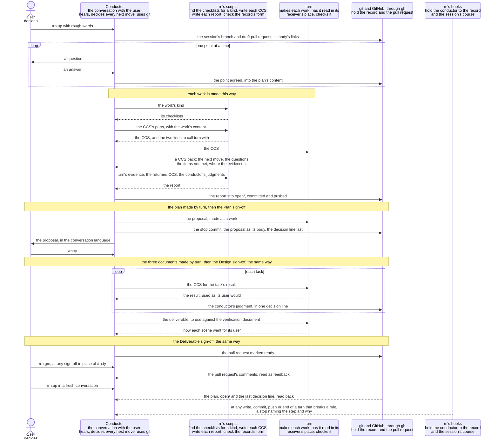

# rn design

rn keeps what its [README](../README.md) promises by one split: the conductor, the conversation
with the user, decides everything, and turn, the plugin rn is built on, makes everything. The
conductor hears what the user really wants one point at a time, writes what each work must say,
calls turn once for it, judges what turn returns by the work's purpose, and proposes at each
sign-off, where the user looks at the work before it goes on. A work is one thing made for one
purpose, one file or several, such as the plan, a document, a task's result or a proposal. turn
makes each work, has it read or used by an AI that did not make it, as the person it is for would,
and checks each item of its checklists. So nothing reaches the user that was not read in its
receiver's place, and the user is asked nothing that could be looked up.

How to use rn is in its README. What turn does with a call is in
[turn's design](../../dev/turn/design.md), and how a caller makes one is on
[turn's callers' page](../../turn/calling-from-a-plugin.md). What each kind of work must give is in
[rn's checklists](../checklists/). A statement no trial has checked yet is marked "(assumption)".

## Goals

rn works in sessions. A session carries one goal of the user's through to the end, on its own
branch with a draft pull request, and keeps its record in a folder of its own and in its commits.
It stops for the user at three sign-offs, where the user approves with `/rn:ty` or gives feedback
with `/rn:gm`:

- The Plan sign-off, on the plan: `steering.md`, with the goal and why, the acceptance criteria,
  the facts and assumptions the work rests on, the rules, and the tasks.

  The acceptance criteria are split after the Kano model (Kano, Seraku, Takahashi and Tsuji,
  "Attractive quality and must-be quality", 1984) into attractive quality, what would make the
  user choose the result, `A1`..., and must-be quality, what they take for granted, `M1`...; each
  task, check and judgment refers to a criterion by its ID.
- The Design sign-off, on the design: the README, the design document and the verification
  document the plan names, as they will stand once the goal is achieved.

  They belong to the product and stay after the session. The verification document holds, for
  each attractive criterion, a scene, a situation the product's user is put in to try it, and the
  machine checks as commands.
- The Deliverable sign-off, on the deliverable: everything the session changed apart from its
  record's folder.

Each work is of a kind, such as a plan, a README or code, and is made against the checklists rn
finds for its kind: its own, or one the user made. For each work the conductor writes its content,
what the work must say or do, item by item of those checklists, from what was agreed; the record
keeps it beside the work. turn keeps its judgment on each item, with the lines that give it, as its
evidence. From that evidence, the report on a work says first what the conductor decided for the
user, each with its ground, each question and item turn left with the judgment on it, and each
change the conductor made after turn; then each item of the checklists, met with the lines that
give it or not met. The report waits in the record until it is settled.

### Attractive quality

- What they really want from rough words: rn asks why the user wants the goal and what the result
  should do for them, one point at a time, and offers ways only after the user has said what they
  want, so what they get is what they meant.

  What the repository and the documentation can tell, rn looks up; each way it offers comes with
  what it gives and costs, and the one it recommends.
- Called only for decisions that are theirs: between sign-offs the user is asked only what the
  goal, the repository, the documentation and best practice cannot settle, and never watches the
  work.
- Decided from the proposal alone: at a sign-off the user says yes or no from the proposal, what rn
  puts to them there, without reading the work over.
- Goes on from where it stopped: tomorrow, or a fresh conversation, takes up the session from its
  record without the user explaining anything again.
- Read in its receiver's place before the user sees it: every work, the plan, the three documents,
  each task's result and each proposal, is read or used by an AI that did not make it, as its
  receiver would, and checked item by item before it reaches the user.

  What falls short is made again, or settled by the conductor, first.

### One-dimensional quality

Each must be no worse than in the version in use.

- Questions answered: how many questions the user answers in a session, beyond the sign-offs.

  Each one beyond what only they could decide is time they spend on what rn could have settled.
- Time and tokens to each sign-off: what a session takes from its start to each sign-off.
- What the user reads at a sign-off: the length of the proposal, which grows only with what the
  user decides, not with the work checked.

### Must-be quality

- The default branch untouched: the default branch changes only when the user merges.
- Every decision pushed: every decision is committed and pushed as it is made, with a decision
  line, and every settled item of `open/` is whole in the commit that settles it.

  `open/` holds what is not yet settled, one file per item: a `report` on a work, the user's
  `feedback` in their own words, or `notes` on a question being put to the user or where a paused
  task stands. The decision line is the last line of every commit,
  `● {#id task name | plan | design | deliverable} ── {what was decided} → {next move}`, and the
  one on the branch's last commit is where the session stands. A stop commit is one where rn stops
  for the user: at a sign-off, after `/rn:ty` or `/rn:gm`, or on `/rn:dn`.
- The record's form: the record keeps the form every command and check reads it by, in the plan,
  the names of the files in `open/` and the verification document, and every ID referred to
  exists.
- A sign-off passed only by approval: a sign-off is passed only by the user's `/rn:ty`, and is put
  to them with nothing unsettled behind it.
- Nothing reaches the user unread: each work the user sees was last read in its receiver's place by
  turn, or the change made to it after that reading is in its report with its lines.
- Missing tools: without python3, jq or gh, rn stops before anything and says what to install, and
  outside a session rn's hooks do nothing.
- Installs with turn: rn installs from the marketplace with turn, and passes strict validation.

### Backward compatibility

- The commands `/rn:up`, `/rn:ty`, `/rn:gm` and `/rn:dn`, which users type, keep doing what each
  does: `/rn:up` starts a session from the words given it or takes up the one on the branch,
  `/rn:ty` approves the sign-off waited for, `/rn:gm` records feedback, from its words or from the
  pull request's comments, and `/rn:dn` pauses.

  `/rn:on` of 0.9.0 is gone: typed, rn says to use `/rn:up` with the same words. What each command
  says may change.
- The record, the session's folder `.rn/{yyyymmdd}-{slug}/` and its commits, which every later
  version of rn relies on to find a session where an earlier one left it, and the users who read it
  rely on as well, stays readable as it was left: `steering.md` in the plan checklist's form,
  `open/` with its kinds and names, the decision lines and the stop commits.

  A session recorded by 0.9.0 is taken up as it stands, since its form is the same; a session from
  before 0.9.0 has its goal worked out again, as 0.9.0 did. How the record keeps each work's content
  may change.
- The pull request, which the user and GitHub rely on, keeps a body that links `steering.md`, with
  `Closes #N`, `Refs #N` and the pull requests it replaces, and is marked ready at the Deliverable
  sign-off.
- rn's checklists, which turn reads by the name and version each opens with and which users copy,
  each keep opening with their name and version in the form turn's README gives, an item's ID
  always means the same item, and a checklist's version goes up once for each release that changes
  it.

  A checklist the user made at `.rn/checklists/<kind>.md` is used for its kind.
- The verification document, which whoever runs the product's checks again relies on, and turn,
  which uses the deliverable against it, keeps its form as the verification checklist gives it,
  with a scene under `### A1:` for each attractive criterion and the machine checks as commands.

### Non-goals

- Making, reading and checking a work: these are turn's, so rn holds no maker, no reader and no
  checker of its own.

  The conductor judges turn's result, rather than a second checker of rn's own.
- Hunting must-be gaps off the golden path, the path the attractive criteria run along: a must-be
  gap is fixed when it stands in the way on that path, and otherwise let go with its reason in the
  record.

  Clearing every gap never ends, and takes the time that raises the attractive quality.
- Keeping checklists for kinds of work beyond rn's own: for a kind rn has no checklist for, one is
  made with the user against the checklist rn keeps for writing checklists, at
  `.rn/checklists/<kind>.md`, and used from then on.
- Running `/clear`: a plugin cannot, so the user runs it and then `/rn:up`.

### Constraints

- rn runs in Claude Code, on a person's behalf, and holds only skills, hooks, scripts and
  checklists; installing copies only its folder, with turn installed beside it.
- rn uses turn only as turn's callers' page gives it: the skill `turn:up` started with a CCS, the
  JSON file through which a caller hands turn one work to make, and the CCS turn writes back.

  turn may change everything inside.
- A subagent cannot ask the user, and turn asks nothing while it works.
- The repository has its remote on GitHub, and `gh` is logged in with push access.
- Users' machines run Python 3.9 or later with the standard library only, and jq.
- rn's hooks run in every session of Claude Code where rn is installed, in repositories without rn
  as well.

## Verification

### Attractive quality

Each benefit is tried as its user on the practice repository `lovaizu/rn-try`, one run at a time,
from a fixed state, with a stand-in, an AI playing the user from a part that says only what the
user knows. Each is judged from the records: the JSONL of the conversation and of every agent, the
commits, the pull request and the product. Each passes on what happens to the user, not on the
shape of what rn writes.

The flow, from `/rn:up` through the plan, the design, one task and the Deliverable sign-off, is
tried apart from what turn makes, on the smallest session that shows it: one line added to the
practice repository's README, with a plan of one attractive criterion. So this flow session
spends no real work's cost and fails only where the flow breaks. The scenes, their fixtures and
their trials are given in [rn's verification document](verification.md); here is what each
passes on.

The benefits are tried on real work in one session: `/rn:up move src/account to TypeScript` on a
repository whose account helpers show "undefined undefined" for a user with no name. This is the
account session.

- What they really want from rough words: the account session, from its start to its first
  call to the stand-in, and from its first Plan sign-off, with feedback on a name shown as "Ann
  null", to the next.

  Passes when, before any way is offered, rn asks why the user wants it, and the plan it stops
  with after the feedback covers every form an absent name takes that the stand-in named: missing,
  `null` and `""`.
- Called only for decisions that are theirs: the account session, from the stand-in's reason
  recorded to the Plan sign-off.

  Passes when no question asks what the repository or a run could tell, each question about means
  comes after the stand-in said what it wants and gives each way's cost, and each message asks one
  point. Beside the trial, the hooks that hold it are tested in each case that would break it: an
  agent started in the background, a turn ended with nothing to decide, and a last message in the
  wrong language.
- Decided from the proposal alone: the account session at its Plan sign-off.

  Passes when the stand-in, given only the proposal, decides without asking back, and each item the
  proposal shows met is met at the lines it names.
- Goes on from where it stopped: the coupon session, a second session on the same repository,
  paused with `/rn:dn` in the middle of a task and taken up with `/rn:up` in a fresh conversation.

  Passes when the fresh conversation goes on from the task's state with no question to the
  stand-in, and carries the task to its decision line.
- Read in its receiver's place before the user sees it: each sign-off of the account session.

  Passes when the records show the plan, the three documents and the proposal made by turn and read
  by an AI in its receiver's place before the stop commit, and each task's result used by it before
  the conductor decided on it.

### One-dimensional quality

All three are measured from the records of the account session, run on this version and on the
version in use, the last release (0.9.0 as this document is written), and each is compared with the
same session on the version in use:

- Questions answered: the questions the stand-in answered.
- Time and tokens to each sign-off: the minutes and tokens from the session's start to each
  sign-off.
- What the user reads at a sign-off: the lines of each proposal.

### Must-be quality

Each is a test on the hook or script that holds it, in the case that would break it:

- The default branch untouched: a commit made on the default branch, and a push to it, each
  stopped by a hook.
- Every decision pushed: a commit without a decision line, a commit not pushed, a settled item not
  whole in its commit, and a commit or push by anyone but the conductor.
- The record's form: a plan, an `open/` name or a verification document off its form, and an ID
  that does not exist.
- A sign-off passed only by approval: a sign-off passed without `/rn:ty` typed, feedback taken
  without `/rn:gm`, a pause without `/rn:dn`, and a stop commit at a sign-off with anything
  unsettled left in `open/` or without the default branch merged.
- Nothing reaches the user unread: a proposal naming an item met where turn's evidence does not.
- Missing tools: each tool missing, in a session and outside one, and rn's own hooks in a
  repository with no session of rn's.
- Installs with turn: `claude plugin validate --strict` passes for rn and for the marketplace on
  every push, and rn's manifest names turn among its dependencies.

### Backward compatibility

- The commands: a trial types each, and `/rn:on`, on the flow session, and passes when each does
  what Backward compatibility says.
- The record: a test takes up a session recorded by 0.9.0 from a fixture and passes when `/rn:up`
  goes on from its last decision line; a session from 0.8.0 passes when its goal is worked out
  again.
- The pull request: the flow trial passes when the body holds the links and the pull request is
  marked ready at the Deliverable sign-off.
- rn's checklists: a test has turn's own script read every checklist rn keeps into its list, and
  finds each one's name, version and items; a test on the script that finds the checklists for a
  kind finds `.rn/checklists/<kind>.md`.
- The verification document: the flow trial's deliverable is used by turn against the session's
  verification document, and the test on the record's form reads one.

## Architecture

### Structure

The conductor is the main conversation of Claude Code, the same one throughout the session; Claude
Code also runs rn's hooks and turn. rn's manifest takes part only at install, outside any session:
Claude Code reads it to install turn with rn. What each cannot work without:

- The conductor: the record, turn, rn's scripts and checklists, and git with its remote on GitHub.
- turn: the CCS, git, python3 and jq, as its README says.
- rn's scripts: python3 and jq.
- rn's hooks: python3, and Claude Code to run them.
- The pull request: `gh` logged in with push access.

### Principles

- Attractive quality is the goal: its checks are the fewest that confirm it, each improvement goes
  where it raises it soonest, and must-be quality is checked by machine, fixed where a gap stands
  in the way on the golden path, and finished last.

  Protects: What they really want from rough words, Questions answered, Time and tokens to each
  sign-off.
- Only the conductor decides what happens next, and only the conductor uses git.

  A decision is made where the goal and the whole conversation are known, and every commit records
  one someone made. Protects: Decided from the proposal alone, Every decision pushed, Goes on from
  where it stopped.
- Every work is made by turn from what the conductor decided, and read in its receiver's place
  before the user sees it.

  The conductor makes nothing the user sees itself but the record and what it finishes after
  turn's last run, each change in the report. Protects: Read in its receiver's place before the
  user sees it, Nothing reaches the user unread.
- turn runs once on a work, and again only when what it was given must change much.

  A small shortfall the conductor fixes itself, after turn's last run, since turn on the same
  inputs returns the same judgments; turn writes over a file only when git holds it. Protects: Time
  and tokens to each sign-off, Nothing reaches the user unread.
- The user is asked only what the goal, the repository, the documentation and best practice cannot
  settle.

  What only the user knows and they do not know is an assumption, shown as a shortfall until
  checked. Protects: What they really want from rough words, Called only for decisions that are
  theirs.
- Everything is made and checked by the same checklists, and rn is improved by sharpening them,
  not by adding steps.

  A checklist asks what the receiver gets, so it fits situations no one foresaw. Protects: Read in
  its receiver's place before the user sees it, What the user reads at a sign-off.
- Whoever reads for rn is handed the paths of what it reads, never a summary of them.

  The conductor names in the CCS the files the work follows and the files its receiver opens, and
  turn's agents leave their whole results in files and return only where they are. Protects: What they really want from rough words, Goes on from where it stopped.
- Decisions are written into the record before the work that follows them, and the record holds
  only what holds now.

  How a thing was reached lives in the commit messages. Protects: Goes on from where it stopped,
  Every decision pushed.

### Hearing what the user really wants

Brings about: Attractive quality: What they really want from rough words, Called only for
decisions that are theirs. One-dimensional quality: Questions answered.

The conductor works out the plan itself, in the conversation it holds, before anything else, and
the plan has its own sign-off, since a design worked out on a wrong goal is wasted.

It asks the way of a careful interviewer working down a tree of decisions, as in mattpocock's
`grilling` skill (MIT, commit `d81f3a1`): only a point whose prerequisites are settled is asked, one
point per message. An intent question asks why the user wants the goal and what a result should do
for them, with no way offered and no recommended answer, and its answer is written in the user's
words as an attractive criterion. A means question offers ways only where the criteria allow ways
that give different things, each with what it gives and costs and the one recommended. Facts the
repository, the official documentation or best practice can show are looked up; a fact none can
show, such as what the user's records hold or every form an input takes where the product runs, is
asked. The hearing is done when nothing is silently assumed, and what the user does not know but
says to go on with is an assumption.

Each point is written into the plan's content as soon as it is agreed, as a decision of its own, so
a pause loses none. The languages the record and the talk are in, and the issues the work closes,
are among the points.

Who takes part: the user, the conductor, the record.

Weighed and not chosen:

- Depending on `grilling` instead of taking its way in.

  Installing it brings many skills, it starts on any mention of "grill", and its tags cannot pin a
  version.
- Every ready question at once.

  With several, the user answers the one they follow and the rest go half-decided (the user's own
  experience).

### Making a work through turn

Brings about: Attractive quality: Read in its receiver's place before the user sees it, Decided
from the proposal alone. One-dimensional quality: Time and tokens to each sign-off. Must-be
quality: Nothing reaches the user unread. Backward compatibility: rn's checklists.

Each work, the plan at the Plan sign-off, the three documents at the Design sign-off, each task's
result, the deliverable's use and each proposal, is made the same way. The conductor writes the
work's content from what was agreed and nothing else. A script writes the CCS from the parts the
conductor gives it: the content, the checklists for the work's kind, where each file goes, the
receiver, their use and what they must be able to do, what the work follows and what the receiver
opens with it; the conductor calls turn with that CCS and waits, since turn asks nothing while it
works.

turn writes back a CCS with the next move, the questions only the user can decide, each item not
met with how the work would meet it, and where it keeps its evidence, the lines that give each item
met. On each item, the conductor calls what the user gains a Good, which a fix must not take away,
and what they will struggle with a More. It judges each question and each item not met by one
test, what the purpose needs: needed when the receiver's use, or a decision of the user's, rests on
it; otherwise not, and left with why. Where
serving the purpose needs a large change in the content, it corrects the content and runs turn
again, and only then; otherwise it finishes the work itself after turn's last run, each change kept
for the report. A question the purpose needs is asked, one per message.

A script writes the report from turn's evidence, the returned CCS and the conductor's judgments,
and stops until every question and item turn returned is judged, so nothing turn returned is
dropped. The report goes to `open/` and is settled whole in the commit that settles it.

Who takes part: the conductor, rn's scripts, turn, the user.

Weighed and not chosen:

- Running turn until every item is met.

  Each run raised finer questions the purpose did not need (seen in three runs on a CSV tool's
  README, 2026-10-14).
- An agent of rn's own set to check turn's result.

  A fresh agent set to check a README judged beyond the README's scope and disagreed with turn
  (seen once, 2026-10-14), and only the conductor knows what was agreed.
- The conductor asking the user each question as it is seen.

  turn asks nothing while it works, so all its questions come at once at the end.

### Sign-offs and proposals

Brings about: Attractive quality: Decided from the proposal alone. One-dimensional quality: What
the user reads at a sign-off. Must-be quality: A sign-off passed only by approval.

At a sign-off, every report and feedback is settled, and the branch has the latest default branch
merged in. The conductor writes the proposal's content, the final state only: what it proposes next
and why, how far the work gives each attractive criterion and what came closer, what changed since
the last approval and what the design takes away, what it decided for the user, each shortfall left,
each assumption as a shortfall, and each item of the work's checklists as turn's evidence shows it.
turn makes the proposal against the checklist rn keeps for proposals, read as the user would. The
conductor commits it as the stop commit's body, with the decision line last, and gives the user that
body translated into the conversation language, adding nothing and leaving nothing out.

The points and fixes along the way are left out, since the user approves the final state; a
must-be gap let go off the golden path stays in the record, not in the proposal.

Who takes part: the conductor, turn, the record, the user.

Weighed and not chosen:

- A report of where things stand.

  It leaves the user to work out what to do next, which is the work they left to rn.
- Every Good and More of every use listed.

  The proposal then grew with the work checked, not with what the user decides (#46).

### Feedback

Brings about: Attractive quality: What they really want from rough words, Decided from the proposal
alone.

Feedback is the user's words with `/rn:gm`, or, when none are given, every comment the `gh` user
wrote on the pull request after the stop commit. It is kept whole in a `feedback` item in `open/`,
and the session goes back to working out the plan or the design, taking the mismatch behind the
words as the first point, since fixing only what the words say leaves the mismatch in place.
Feedback on the deliverable gets tasks for it, or goes back to the design when it changes what the
product should be. Work that went back always stops at that sign-off again.

Once approved, the plan and the documents go back through their sign-off only when what they say
changes without the user having decided it.

Who takes part: the user, the conductor, the pull request.

Weighed and not chosen:

- Acting on feedback point by point as worded.

  The mismatch behind the words stayed in place.

### Tasks and the deliverable

Brings about: Attractive quality: What they really want from rough words, Called only for decisions
that are theirs. Backward compatibility: The verification document.

The tasks are planned only once the design is approved, since tasks planned before it would mostly
be rewritten. They are planned in the way of `wayfinder` in the same repository as `grilling`:
decisions settled one at a time, each before the tasks that rest on it, and what cannot yet be
stated kept apart in the plan until it can be. Each task names its purpose, the criteria it serves
and completion criteria split by Kano quality, and tasks raise attractive quality first.

Each task is a work made through turn, with the design and the repository's rules as what it
follows and the code checklist, or the kind's, as its measure. The conductor checks what turn
returned against the task's purpose on the real thing, in one decision line: it sends the task back
with the content corrected where the purpose is not fulfilled, goes back to the design where the
design does not let it be fulfilled, and asks the user what only they can decide.

When the tasks planned after the last Design sign-off are done, the deliverable is used once: turn
uses the product as its user would against the verification document, whose scenes are its items,
and the conductor runs the machine checks. Each More to fix becomes a task before the Deliverable
sign-off, and the whole is not used again, since each fresh use raises points that are not
essential.

Who takes part: the conductor, turn, the record.

Weighed and not chosen:

- A maker and a first user of rn's own for each task.

  turn makes, reads and checks every work one way, and rn's own reading was a second copy of it.

### The record and the pull request

Brings about: Attractive quality: Goes on from where it stopped. Must-be quality: Every decision
pushed, The default branch untouched. Backward compatibility: The record, The pull request.

A session works on its own branch from the latest default branch, with a draft pull request whose
body links `steering.md` and the issues, and never takes in the user's uncommitted changes. Since
every decision is pushed, `/rn:up` takes up the next move from the branch's last decision line,
wherever the session was left. A settled item leaves `open/` copied into the message of the commit
that settles it, with what was decided on each point, so the record lives in git and shows each
finding beside what became of it. The content of each work is committed with the record, so each
item met traces back to what was asked of it; turn's evidence is left uncommitted, since the report
holds what the record needs.

When a session is taken up, and before each sign-off, the branch is brought up to the latest
default branch, and what that changes is worked out again before the sign-off. When Claude Code
summarizes the conversation partway, a hook has the conductor read the record again, since a
summary drops details the record holds whole.

Who takes part: the conductor, git and GitHub, rn's hooks.

Weighed and not chosen:

- Findings kept as files under `.rn/`.

  The record then held what was read past, and the commit messages already hold each finding
  beside its decision.

### The commands

Brings about: Attractive quality: Goes on from where it stopped. Must-be quality: A sign-off passed
only by approval, Missing tools. Backward compatibility: The commands.

`/rn:up` starts a session from the words given it when the branch has none, and otherwise takes up
the one on the branch from its record, so one command serves both and the user need not remember
which. `/rn:ty` and `/rn:gm` record the user's answer and stop, so the user can clear the
conversation at any sign-off. `/rn:dn` records how far the session has come, a task under way
included, and stops. Each command runs only when the user types it. Before anything else,
`/rn:up` checks that python3, jq and gh are there and says what to install when one is not; rn's
hooks run only where python3 is found and a session of rn's is open, so outside one they do
nothing.

Who takes part: the user, the conductor, the record.

Weighed and not chosen:

- Keeping `/rn:on` beside `/rn:up`.

  The record tells whether a session is there, and two commands for one move are one more thing to
  learn.

### Hooks check rn's rules as it goes

Brings about: Attractive quality: Called only for decisions that are theirs. Must-be quality: Every
decision pushed, The record's form, A sign-off passed only by approval, Nothing reaches the user
unread.

What a machine can judge of these qualities is checked by hooks at the moment it could break:
after each write, before each commit is pushed, and at each end of a turn. So a breach is stopped
where it happens, and each stop says which step went wrong and why; the cases each check stops are
those Verification tests the qualities by.

Who takes part: rn's hooks, Claude Code, the conductor.

Weighed and not chosen:

- Telling the conductor its rules in words only.

  A rule in words is kept on some runs only (assumption, from turn's design).

### Installing with turn

Brings about: Must-be quality: Installs with turn.

rn's manifest names turn among its dependencies, so installing rn installs turn, and the manifest
passes `claude plugin validate --strict`, alone and in the marketplace.

Who takes part: rn's manifest, Claude Code.

Weighed and not chosen:

- Telling the user to install turn as well.

  A user who misses it gets an rn that cannot work.
