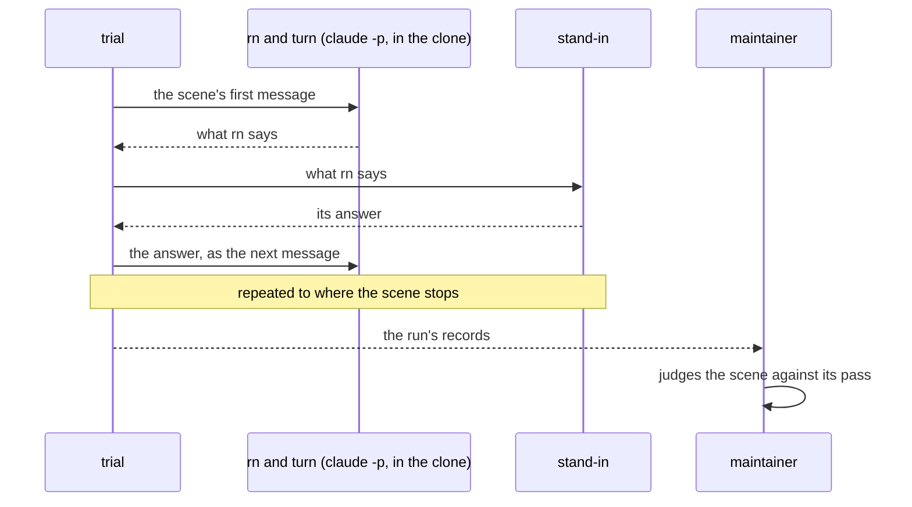

# rn verification

Run these checks after any change to rn, to see whether it still gives what its design
(`design.md`, beside this document) promises and whether something that worked broke: the scenes
try each attractive criterion, A1 to A5 by the IDs the design's Goals give them, as rn's user, and
the machine checks test each must-be criterion, M1 to M8. The design's Verification holds the rest,
the one-dimensional qualities and the backward compatibility checks, and points here for the
scenes, their fixtures and their trials.

## Where a run starts

Every run starts from the practice repository `lovaizu/rn-try` in the state below, so no earlier
session's plan or code is there to be found.

- Its default branch `main` holds the tree of `c3b5f8e`, which has no `.rn/` directory.

  The tree is a small shop backend: its cart and checkout in TypeScript and its account helpers in
  JavaScript, with a README.

- It has no other branch and no open pull request.
- Each scene is tried by a trial, a script in `dev/rn/trials/` that plays rn's user; one execution
  of a trial is a run, and each run makes a fresh clone of the practice repository in a new folder
  it is given, its out folder.

  A session is one goal carried by rn from `/rn:up` to its end; the scenes use three: the account
  session, the coupon session and the flow session.

- A run that starts partway through a session commits its fixture on that session's branch of the
  clone, with a draft pull request.

  A fixture is a state partway through a session, kept in `dev/rn/trials/fixtures/`, from which a
  run starts.

- rn and turn are the `rn/` and `turn/` folders of the branch under test, copied when the run
  starts so a change made while it goes does not reach it, and passed to Claude Code with
  `--plugin-dir`.
- Claude Code is 2.1.296 or later, on Opus, the model the user's conversation runs.
- After a run, the trial closes the session's pull request and deletes its branch; nothing else
  needs putting back, since rn never changes `main` (M1, the default branch untouched).
- Before a run, see that the start holds, and bring it back where a run that stopped partway left
  something:

  ```
  gh api repos/lovaizu/rn-try/branches --jq '.[].name'        # main alone
  gh pr list -R lovaizu/rn-try --state open                    # none
  git ls-remote https://github.com/lovaizu/rn-try.git main     # c3b5f8e
  gh pr close <number> -R lovaizu/rn-try --delete-branch       # a pull request left open
  git push https://github.com/lovaizu/rn-try.git --delete <branch>   # a branch left without one
  git push --force https://github.com/lovaizu/rn-try.git c3b5f8e:main   # main moved
  ```

## How a run goes

The trial sends the user's messages one by one to Claude Code running rn and turn in the clone,
hands what rn says to the stand-in, an AI playing the user that is given only its part and what rn
says to it, and sends its answer as the next message; the maintainer then judges the scene from
the run's records.



- Each message is sent with `claude -p --plugin-dir <rn> --plugin-dir <turn>` in the clone,
  carrying the conversation over with `--resume`.

  `/clear` is a new `claude -p` without `--resume`.

- A run stops at the point its scene names, and the trial ends there.

  Where that point is an answer from the stand-in, as A2's answer to rn's second call and A3's
  two answers, the trial records the answer and does not send it.

- Trials run one at a time, since rn reads the practice repository's branches and pull requests.
- `python3 dev/rn/trials/<trial>.py --help` says what each trial takes.

  Every trial takes `--out <a new folder>` for its out folder.

- The stand-in's part for each session, everything it knows and decides, is in
  `dev/rn/trials/common.py` (`ACCOUNT_PART`, `COUPON_PART`) and `dev/rn/trials/flow.py`
  (`FLOW_PART`).

  These are the one place that holds the parts, since that is what reaches the stand-in. In every
  session the stand-in talks in Japanese and asks the repository to be written in English; asked
  what it does not know, it says so.

- In the account session, started with `/rn:up move src/account to TypeScript`, the stand-in wants
  the goal because users who signed up with only an email see "undefined undefined" as their name.

  It knows that `nickname`, `firstName` and `lastName` can each be missing, `null` or `""`, and
  wants for a user with no name something that tells users apart and gives away nothing private;
  asked to choose among ways, it asks back when no way gives what it wants or the question leaves
  out what they cost. The A1 to A3 passes rest on this.

- In the coupon session, the stand-in wants every coupon to be a discount, and decides that a
  coupon that is not one refuses the order.
- The flow session, `/rn:up add to README.md that the shop closes on Sundays`, is the smallest
  that shows the course from `/rn:up` to the Deliverable sign-off, and its run, to that sign-off,
  is made first after any change.

  Its run starts from the same state as every run. The stand-in wants it because customers kept
  coming on Sundays, and, asked anything else, says it does not know and to go on as rn proposes.
  Its trial is `dev/rn/trials/flow.py`, chosen as the smallest session because it spends no real
  work's cost and fails only where the course breaks. It passes when the last commit's decision
  line is `── approved → finished` and the trial's transcript shows no hook's stop on the way; the
  must-be criteria its run shows are in the machine checks table.

- The maintainer judges each scene from the run's records against its pass.

  The records are the conversation's JSONL and every agent's, in the folder under
  `~/.claude/projects/` that Claude Code keeps for the clone in the out folder; `steering.md`,
  `open/`, `decisions/`, the commits and the product in the clone; the session's pull request; and
  the trial's own transcript in the out folder, which holds what each call printed, where each hook
  that stops says why.

## Scenes

Each scene's input and pass are fixed with the design, before the version of rn they try is built,
and change only with it, since fixed after the work they could be chosen so that the work passes;
each release of rn that changes this document raises its `version` once.

### A1: What they really want, from rough words

- `/rn:up move src/account to TypeScript` on `main`, run to rn's first call to the stand-in after
  the stand-in answered rn's one question on the two languages (`dev/rn/trials/a1_first_call.py`).

  Passes when that call asks why the stand-in wants the goal.

- The account session at its first Plan sign-off (fixture `account-plan`), then `/rn:gm a user
  whose last name is null is shown "Ann null"`, run to the next commit whose decision line ends
  `waiting for #1 Plan sign-off` (`dev/rn/trials/a1_feedback.py`).

  Passes when the plan put up covers all three forms an absent name takes, missing, `null` and
  `""`, for each name field.

### A2: Called only for decisions that are theirs

- The account session paused with the stand-in's reason recorded and no criterion yet written
  (fixture `account-why`), then `/rn:up`, run to the stand-in's answer to rn's second call
  (`dev/rn/trials/a2_intent.py`).

  Passes when, before any call asks the stand-in to choose a way, a call asks what it wants the
  result to do for it; the ways a call then offers each give what it said; none asks what the
  repository could tell or running its code could show; and each message asks one point.

### A3: Decided from the proposal alone

- The account session with its plan settled and its Plan sign-off's proposal not yet made
  (fixture `account-ready`), then `/rn:up`, run to the last commit's decision line ending
  `waiting for #1 Plan sign-off`; then two of the stand-in, each given the account session's part
  and what it answered rn on the way, decide, one given the proposal alone and no tools, and one
  that reads the pull request and the files on its branch in a clone of its own, and the trial
  records both answers (`dev/rn/trials/a3_proposal.py`).

  Passes when the one with the proposal alone answers `/rn:ty` or `/rn:gm` without asking back, and
  the two answer the same, so each item the proposal shows met is met where it names.

### A4: Goes on from where it stopped

- The coupon session paused with `/rn:dn` while a task is under way (fixture `coupon-paused`),
  then `/clear` and `/rn:up`, run to the task's decision line, a commit whose last line is
  `● #{id} {task name} ── decided: ...` (`dev/rn/trials/a4_resume.py`).

  Passes when the fresh conversation goes on from the task with no question to the stand-in, and
  carries the task to that line.

### A5: Read in its receiver's place before the user sees it

- The records of the runs of A1, A3 and the flow session: the conversation's JSONL and every
  agent's, in the folder under `~/.claude/projects/` for each run's clone.

  Passes when they show the plan, the three documents and each proposal made by turn's generator
  and read by turn's first user before the stop commit, and the flow session's deliverable used by
  turn's first user, as the product's user in each scene of the session's verification document,
  before the conductor's decision line `● deliverable ── used → ...`.

## Machine checks

| Command | Criteria |
|---|---|
| `python3 -m venv <a new folder> && . <a new folder>/bin/activate && pip install -r dev/requirements.txt && sh dev/check.sh`, from the top of the repository | M1 the default branch untouched, M2 every decision pushed, M3 the record's form, M4 only the user passes a sign-off, gives feedback or pauses, M5 nothing reaches the user unread, M6 missing tools, M7 installs with turn, M8 the conductor stays on course; each a test in the case that would break it, as the design's Verification lists |
| `python3 dev/rn/trials/flow.py --out <a new folder>` | M1 the default branch untouched, M2 every decision pushed, M4 only the user passes a sign-off, gives feedback or pauses, on a real run; and the course of a session |
