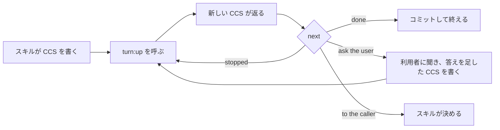
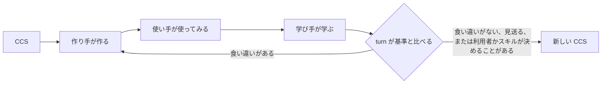

# turn

長いタスクを AI エージェントに任せると、やりとりが積み重なってコンテキストが膨らみ、エージェントは次第に目的や決まりからずれていきます。[ACC（Agent Cognitive Compressor）](https://arxiv.org/abs/2601.11653) は、これを防ぐために研究で示されたやり方です。やりとりの全部を持ち続けるかわりに、ターンごとに、次の一手に要る状態だけを、CCS（Compressed Cognitive State）という決まった9つの部分の形にまとめ直し、前の状態と置き換えます。詳しくは論文をご覧ください。

turn は、この1ターンを、AI に何かを作らせるプラグインのために形にしたものです。1ターンで、作って、使ってみて、つまずいた理由を学び、直します。プラグインはタスクを CCS の JSON に書いて渡し、新しい CCS を受け取ります。

## プラグインの作者にとって

- 作って、使ってみて、直す流れを、自分のスキルに書かずに済みます。

    書くのは、タスクの CCS と、そのドメインで良い成果物とは何かを書いた観点のファイルだけです。流れを直したくなっても、turn の1か所で済みます。

- 成果物を読まずに、次の一手を決められます。

    返ってきた CCS の `next` を `jq` で1行読めば、終わったのか、利用者に聞くことがあるのかが分かります。

- 合格の基準や決まりが、タスクの途中で書き換わりません。

    turn が CCS を返すたびに、プラグインが書いた部分がそのままかを機械が確かめます。

## プラグインの利用者にとって

- 見せられる成果物は、すでに使われ、つまずいた所が直っています。
- 聞かれるのは、利用者にしか決められないことだけです。
- 途中で止めても、続きから進みます。CCS と成果物をコミットしておけば、別のマシンでも続きから進みます。
- 利用者のほかの作業に触れません。

    成果物を使ってみるのは、使い終えたら消す一時フォルダの写しの中です。turn はコミットも push もしません。

## 使う場面

新人向けのセットアップ手順書を作るプラグイン `setup` を例にします。利用者がプラグインを呼ぶと、次のように進みます。

```text
> /setup:guide

  手順書（SETUP.md）を作ります。
  ⎿ turn: 作っています
  ⎿ turn: 新人になりきって、クローンしたばかりの写しで使っています
  ⎿ turn: 4番目の手順で止まりました（var/ がない）。直して、その手順から使い直しています
  ⎿ turn: 最後まで使えました

  1つだけ教えてください。
  API トークンは、新人に誰が渡しますか。

> 運用担当の佐藤さん

  ⎿ turn: 答えを入れて、トークンの手順を使い直しています

  SETUP.md ができました。新人になりきって使い、誰にも聞かずにアプリの起動まで進めました。
```

その裏で、プラグインのスキルと turn は、CCS を受け渡しています。



スキルがするのは、CCS を書くこと、`turn:up` を呼ぶこと、返ってきた CCS の `next` を見て次を決めることの3つです。作る、使ってみる、直す、は turn がします。

## ターンの考え方

人は、作ったものを自分で使ってみて、つまずいた所を直してから、受け取る人（受け手）に渡します。turn は、この一続きを `turn:up` 1回で受け持ちます。



- 作り手、使い手、学び手は、別々のエージェントです。判断するのは、それらを呼ぶ turn だけです。

    作った本人が確かめると、甘くなるからです。使い手は、話し合いも合格の基準も知らされず、受け手になりきって、受け手と同じ状態から使います。基準を知っていると、それに沿って使ってしまい、受け手がつまずく所が見えなくなるからです。

- 学び手は、使うたびに、なぜつまずいたかを学びます。

    成果物について学んだことは、作り手がその場で直します。進め方について学んだことは決まりになり、ターンの残りで守られ、返す CCS にも入ります。

- ターンは、CCS を受け取って始まり、新しい CCS を返して終わります。

    turn は、渡された CCS を書き換えません。次のターンは、返ってきた CCS から始まります。

## CCS の書き方

CCS は JSON のファイル1つです。9つの部分をすべて持ち、各部分は `{"種類": "値"}` の並びです。中身のない部分は、空の並び `[]` にします。成果物や資料の中身は書き写さず、場所だけを書きます。場所は、リポジトリからの相対パスです。どのマシンでクローンしても、同じ場所を指すからです。

部分と種類の名前、`next` の値のような決まった語は英語のままです。種類は、下の2つの表にあるものだけです。それ以外の値は、成果物を書く言葉で書きます。

### プラグインが書くもの

```json
{
  "focal_entities": [
    {"work": "SETUP.md"},
    {"receiver": "今日入った新人。手順書だけでアプリを起動する"}
  ],
  "goal_orientation": [
    {"acceptance": "新人が誰にも聞かずに、手順書どおりにアプリを起動できる"},
    {"use": "クローンしたばかりのリポジトリで、手順を上から順に実行する"}
  ],
  "retrieved_artifacts": [
    {"source": "package.json"}
  ],
  "constraints": [
    {"language": "日本語"}
  ],
  "episodic_trace": [],
  "semantic_gist": [],
  "relational_map": [],
  "predictive_cue": [],
  "uncertainty_signal": []
}
```

| 部分 | 種類 | 書くこと | 必須 |
|---|---|---|---|
| `focal_entities` | `work` | 作る成果物の場所。リポジトリの中 | はい |
| | `receiver` | 成果物を受け取って使う人 | はい |
| `goal_orientation` | `acceptance` | 受け手が成果物で何をできれば合格か | はい |
| | `use` | 受け手が成果物を何に使うか | |
| `retrieved_artifacts` | `source` | 成果物の元にする資料 | |
| `constraints` | `language` | 成果物を書く言葉 | |
| | `rule` | 守る決まり | |
| | `answer` | 返ってきた `gap` への利用者の答え | |

`focal_entities`、`goal_orientation`、`retrieved_artifacts` は、タスクの間ずっと変わりません。`constraints` は、書いた行は変わらず、後ろに足されていきます。turn が学んだ決まり（`rule`）を足し、スキルが利用者の答え（`answer`）を足します。

### turn が書くもの

turn が書く部分は、ターンごとに作り直されます。返ってきた CCS は、たとえば次のようになります（プラグインが書いた部分は省いています）。

```json
{
  "predictive_cue": [{"next": "ask the user"}],
  "uncertainty_signal": [{"gap": "API トークンは、新人に誰が渡しますか"}],
  "semantic_gist": [
    {"difference": "手順4で var/ がなく止まった → fixed"},
    {"difference": "トークンの入手先が書けない → to the caller: 利用者に聞く"}
  ],
  "constraints": [
    {"language": "日本語"},
    {"rule": "手順は、クローンしたばかりの写しで実際に打って確かめてから書く"}
  ],
  "relational_map": [{"link": "SETUP.md ← package.json の scripts"}],
  "episodic_trace": [
    {"maker-1": "wrote SETUP.md"},
    {"user-1": "ran npm start"}
  ]
}
```

| 部分 | 種類 | 中身 |
|---|---|---|
| `predictive_cue` | `next` | 次にすること。「返ってきた CCS で次を決める」の表のどれか |
| `uncertainty_signal` | `gap` | 利用者にしか決められないことを、そのまま聞ける問いにしたもの |
| `semantic_gist` | `difference` | 使ってみて基準と食い違ったことと、その結末。結末は `fixed`（直した）、`let go: <理由>`（見送った）、`to the caller: <理由>`（スキルに任せた）のどれか |
| `constraints` | `rule` | このターンで学んだ進め方の決まり |
| `relational_map` | `link` | 成果物と資料などのつながり |
| `episodic_trace` | エージェントと何回目か（`maker-1` は作り手の1回目、`user-1` は使い手の1回目、`learner-1` は学び手の1回目）、または `git` | 各エージェントが実際に読み、書き、実行したこと。会話の記録と git から機械が書きます |

### 機械が確かめること

turn は、CCS を受け取った時と返す時に、形を機械で確かめます。合わなければ、何が合わないかを言って止まります。

- 受け取った時
  - 9つの部分がすべてあり、ほかの部分がないこと。種類が表にあるものだけで、値が文字列であること。
  - 必須の3つがあること。
  - `retrieved_artifacts` に書いた場所と、`viewpoint` で渡した観点のファイルが実際にあること。`work` がリポジトリの中を指すこと。新しく作るものなので、`work` はまだなくて構いません。
  - 返す先が、まだないファイルであること。
- 返す時
  - `focal_entities`、`goal_orientation`、`retrieved_artifacts` が受け取った時のままで、`constraints` は元の行が残ったうえで足されていること。
  - 部分と種類が、受け取った時と同じく表にあるものだけであること。AI が勝手に足した項目は、ここで止まります。
  - `next` が決まった値の1つであること。

CCS の大きさに上限は設けません。CCS が膨らむのは、タスクが大きすぎる合図です。タスクを分けることを考えてください。

## 呼び方

プラグインのスキルに、次のように書きます。

````markdown
`turn:up` のスキルを、次の3行を引数にして呼ぶ。

```
in: .setup/task-1.json
out: .setup/task-2.json
viewpoint: ${CLAUDE_PLUGIN_ROOT}/viewpoints/setup.md
```
````

- `in` は、渡す CCS です。
- `out` は、turn が新しい CCS を書く場所です。まだないファイルにします。
- `viewpoint` は、観点のファイルです。必須で、複数あれば行を重ねます。

    観点のファイルは、プラグインの中に置きます。`${CLAUDE_PLUGIN_ROOT}` は、Claude Code がスキルを読み込むたびに、インストールされている今のバージョンの場所に置き換えます。そのため、別のマシンでも、バージョンアップのあとでも、同じ書き方で見つかります。場所がバージョンで変わるので、CCS には書かず、呼ぶたびに渡します。

観点のファイルには、そのドメインで良い成果物とは何かを、作り手と学び手が判断に使える形で書きます。手順書なら、たとえば次のようになります。

```markdown
- 新しいクローンからアプリが動くまでを、打つコマンドと、それぞれで見えるものの手順にする。
- どの手順も、今のリポジトリで実際に打って確かめたものにする。
- 人に聞かないと分からないこと（秘密の値など）は、誰に聞くかを書く。
```


turn は同じ会話の中で動き、ターンが終わるか止まった時に戻ります。CCS の置き場所と名前は、プラグインが決めます。

## 返ってきた CCS で次を決める

返ってきた CCS は、必要な所だけを `jq` で読みます。

```sh
jq -r '.predictive_cue[].next // empty' .setup/task-2.json
jq -r '.uncertainty_signal[].gap // empty' .setup/task-2.json
```

| `next` | スキルがすること |
|---|---|
| `done` | 成果物と CCS をコミットして終えます。 |
| `ask the user` | `gap` を利用者に聞きます。返ってきた CCS の `constraints` に、答えを `answer` として足して新しいファイル（`task-3.json`）に書き、それを `in` にして呼び直します。 |
| `to the caller: <理由>` | 理由を見て、スキルが決めます。たとえば、合格の基準を直した CCS を新しく書いて呼び直すか、観点を見直すか、利用者に相談します。 |
| `stopped: <どこから>` | 利用者が turn の途中で、会話で止めるよう言った時です。返ってきた CCS を `in` にして呼べば、そこから続きます。 |

- turn が CCS を返さずに切れた時（マシンが止まった時など）は、同じ `in` でもう一度呼びます。そのターンを始めからやり直します。
- python3 か jq がない時は、turn は CCS を返さずに、何をインストールすればよいかを会話で伝えて止まります。
- 次のタスクにも学んだ決まりを守らせたい時は、返ってきた CCS の `rule` の行を、次のタスクの CCS の `constraints` に写します。

## プラグインに残ること

turn が受け持つのはタスク1つです。次のことは、呼ぶプラグインがします。

- タスクの前に、利用者と何を合意するかを決めること。
- どのタスクを、どの順に回すかを決めること。
- コミットと push。

## 必要なもの

プラグインの利用者のマシンに、次のものが要ります。プラグインの README にも書いてください。

- Python 3.9 以上

    CCS の形の確かめに使います。

- jq

    turn の中のエージェントが、CCS の必要な所だけを読み書きするのに使います。

- git のリポジトリ

    使い手は、リポジトリをクローンしたばかりの状態の写しで使います。

## インストール

プラグインの `.claude-plugin/plugin.json` で turn に依存します。turn と同じ lovaizu/ccpm のマーケットプレイスにあるプラグインなら、次のとおりです。

```json
"dependencies": ["turn"]
```

利用者がプラグインをインストールすると、turn も一緒にインストールされます。

ほかのマーケットプレイスにあるプラグインなら、`"turn@ccpm"` と書きます。そのうえで、自分のマーケットプレイスの `marketplace.json` に `"allowCrossMarketplaceDependenciesOn": ["ccpm"]` を足します。足さないと、Claude Code は turn をインストールしません。
