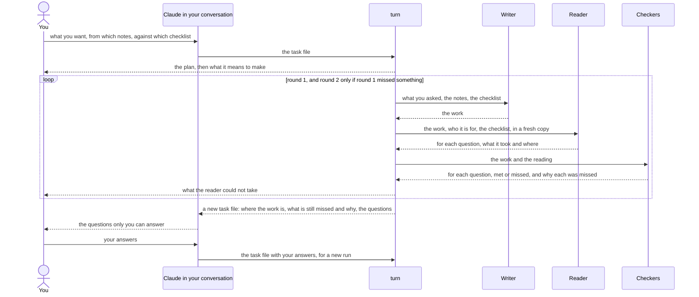

# turn

Have Claude Code make a document or a prompt with turn, and you can hand it on without first
reading it yourself as the person it is for. Before you get it, a second AI, the reader, has read
it as that person would, what it could not take from it has been made again, and you are asked
only what you alone can decide. turn is for anyone who has Claude Code write such work, by asking
in a conversation or from the steps of their own plugin. It does not make code, which is checked
by running its tests rather than by reading.

When Claude checks what it has just written, it checks as the writer, who already knows what each
line means, and passes what the person it is for would miss. turn's reader knows nothing of how the
work was made: it starts where that person starts, and answers each question of a checklist you
choose for that kind of work. For what it missed, turn finds why, and the work is made again
from that cause instead of patched where the miss showed.

## Example

### In a conversation

You want the README of a small command-line tool. You have notes on it, and a checklist for READMEs.
In Claude Code you ask:

```console
> With turn, write the README of this tool for developers who find it on GitHub,
  from docs/notes.md, against checklists/readme.md.
```

Claude writes what you asked as the task file, which says where the work goes, who it is for, what
they use it for, and which notes and checklist to work from, and hands it to turn. One run of turn
goes from that task file to the one turn writes back. turn shows the plan, then, before anything is
written, what it means to make:

```console
Plan: 1 write → 2 read → 3 check   (once more if something was missed; two rounds at most)

Round 1
  1 write   To make: developers who find the tool on GitHub can tell what it saves them
            and run it on their own files.
            .turn/readme/1/README.md
  2 read    Read as a developer who meets the tool on GitHub.
            .turn/readme/1/reading.json
  3 check   ⚠️ The reader could not tell which Python version the tool needs.
            ⚠️ The reader could not picture the result on their own files.
Round 2
  1 write   To make: the same, made again from why each was missed.
            .turn/readme/2/README.md
  2 read    Read again, as the same developer.
            .turn/readme/2/reading.json
  3 check   ✅ Nothing missed.

The README is at README.md.
❓ Which license is the tool under? Your notes do not say, so the README leaves it out.
```

Who does what, and what passes between them:



In each round, the writer writes the work, the reader reads it as the person it is for, and in the
check the checkers, which neither wrote nor read it, judge each question of the checklist and find
why anything was missed; turn decides from what they found. When the first round misses nothing,
turn stops there. When the second round still misses something, turn returns the work as it is, with
what was missed and why, and does not change it again unread.

If the line after `To make:` is not what you want, press Esc and say what you want instead: the work
starts again from what you say.

Claude then asks you the question marked ❓. Answer it, and Claude adds your answer to the task file
and hands it to turn again. That is a new run, with two rounds at most of its own: it starts from
the work as it stands and has the changed work read again before you get it. Work that came back
with something missed is run again the same way, if you choose to.

The paths in the console are where each round's work, and what the reader took from it, are kept,
in turn's folder `.turn/`. turn leaves `.turn/` in place: you open the work and the readings there,
and the next run starts from what the returned task file points to. turn changes nothing in your
repository but the work and `.turn/`, and never commits or pushes; whether to commit them is yours.

### From your plugin

A step of your plugin takes Claude's place above: it writes the task file, calls turn as below, and
decides its next move from the task file turn writes back, which holds the questions for the step
to ask the user.

````markdown
Write this task in .setup/task-1.json, in the form given in turn's `ccs.md`, and call the
`turn:up` skill with these two lines as its arguments:

```
in: .setup/task-1.json
out: .setup/task-2.json
```
````

## Requirements

- Claude Code: turn runs inside it.
- A git repository: the reader reads the work in a fresh copy of it that turn makes and removes,
  so it sees nothing the person the work is for would not have.
- Python 3.9 or later, as `python3`: turn makes the list of questions from your checklist, and
  checks the task file it is given and the one it writes back, with it, using nothing beyond what
  comes with Python.
- jq: turn, and whoever hands it the task file, Claude in your conversation or your plugin's step,
  read and change parts of the task file with it.
- A checklist for each kind of work, as a Markdown file that opens with who reads such work and what
  it gives them, followed by each question under a heading `### <ID>: <title>`: the reader reads as
  the person the opening names and answers the questions one by one. The
  [writ checklists](../writ/references/essentials/) cover documents, READMEs, design documents and
  prompts, and can be used as they are.

When python3 or jq is missing, turn stops before any work and says what to install.

## Installation

In Claude Code, add the marketplace once, then install turn:

```console
> /plugin marketplace add lovaizu/ccpm
> /plugin install turn@ccpm
```

Then ask as in the [Example](#in-a-conversation), with your own notes and checklist. A plugin that
calls turn also names it in `dependencies` in its `.claude-plugin/plugin.json`, so that installing
the plugin installs turn.

## Documentation

- [ccs.md](skills/up/ccs.md): the form of the task file handed to turn and of the one turn writes
  back.
- [CHANGELOG.md](CHANGELOG.md): what changed in each version.

## License

[MIT](../LICENSE)
