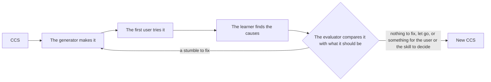

# turn

When you hand a long task to an AI agent, the conversation piles up, the context grows, and the agent slowly drifts from its goal and its rules. [ACC (Agent Cognitive Compressor)](https://arxiv.org/abs/2601.11653) is a method from research that prevents this. Instead of keeping the whole conversation, it rewrites, at every turn, only the state needed for the next step into a fixed form of nine parts, the CCS (Compressed Cognitive State), and replaces the previous state with it. See the paper for the details.

turn puts one such turn into a form that plugins which have AI make something can use. In one turn, it makes the deliverable, tries it out, learns why it stumbled, and fixes it. A plugin writes its task, with what the deliverable should be, as a CCS in JSON, hands it over, and gets a new CCS back.

## For plugin authors

- The deliverable is judged against what you write it should be, and nothing else.

    In the CCS you write who receives the deliverable, what they use it for, what they must be able to do with it for it to pass, and viewpoint files that say what a good deliverable is in your domain. turn tries the deliverable against these and fixes it until it meets them. It never makes up what the deliverable should be; when what you wrote is not enough to decide, it comes back to your skill with the reason. How good the deliverable gets rests on what you write here.

- You do not write the make, try and fix loop in your own skill.

    If the loop needs a fix, it is fixed in one place, turn.

- Everything your skill needs for its next step can be traced from the returned CCS.

    `next` says how the turn ended, `gap` what is left for your user, and the CCS points to the deliverable and everything behind it, the evidence among them: each step taken in trying it, as the conversation records show it, and each ending with the steps and the lines of the deliverable it rests on. Whether to open them is up to your skill.

- What the deliverable should be and the rules do not change in the middle of a task.

    Each time turn returns a CCS, a script checks that the parts your plugin wrote are unchanged.

## For your plugin's users

- The deliverable they are shown has already been used, and the places where it stumbled are fixed.
- They are asked only what only they can decide.
- If they stop partway, the task carries on from where it stopped. If they commit the CCS and the deliverable, it carries on from there on another machine too.
- Their other work is left untouched.

    The deliverable is tried out in a copy inside a temporary folder that is deleted afterward. turn never commits or pushes.

## How a turn works

A person tries out what they made, fixes what tripped them up, and only then hands it to the person who will use it (the receiver). turn does this whole stretch in one call to `turn:up`.



- The generator, the first user, the learner and the evaluator are separate agents. turn calls them in turn and passes on what each returns. Only the evaluator makes decisions, each against what the deliverable should be.

    Whoever made the deliverable goes easy on it when checking it. The first user is told only the deliverable, who the receiver is and what they use it for, never the discussion or the acceptance criteria; it takes the receiver's place and starts from where the receiver starts. If it knew the criteria, it would use the deliverable the way they describe, and the places where the receiver stumbles would not show.

- Each time the deliverable is tried, the learner finds why it stumbled.

    For the deliverable, it finds the cause of the stumble, not just the spot. The generator fixes that cause and remakes the deliverable from it. Patching spot by spot moves the deliverable away from what it should be. A cause in the way of working becomes a rule, which is kept for the rest of the turn and goes into the returned CCS.

- A turn starts by receiving a CCS and ends by returning a new one.

    turn never rewrites the CCS it was given. The next turn starts from the CCS that came back.

## Writing a CCS

A CCS is one JSON file. What matters most in it is what the deliverable should be: only you can write it, and every decision in a turn is measured against it.

### What the deliverable should be

Four kinds of entry say what the deliverable should be.

| Kind | What to write | Who uses it, and for what |
|---|---|---|
| `receiver` | The person who receives and uses the deliverable, and where they start from | The first user takes this person's place |
| `use` | What the receiver uses the deliverable for | The first user uses it for this |
| `acceptance` | What the receiver must be able to do with the deliverable for it to pass | The evaluator decides by it which stumbles must be fixed. The first user is never told it |
| `viewpoint` | A viewpoint file: what a good deliverable is in your domain. One or more | The generator makes the deliverable by it; the learner traces causes by it, and the evaluator decides by it |

The generator and the evaluator get all four. Write them so that trying the deliverable shows whether it meets them:

- `receiver`: a person in a situation, with what they have and do not have. "A new team member on their first day, starting the app from the guide alone" tells the first user where to start; "developers" does not.
- `use` and `acceptance`: what the receiver does, and what shows it worked. "Starts the app by following the guide alone" can be tried; "a clear guide" cannot.
- `viewpoint`: what a good deliverable is in your domain, each line something the deliverable can be checked against. For a setup guide, it might say:

```markdown
- Go from a fresh clone to a running app, as steps of commands to type and what each one shows.
- Every step has been typed and checked in the current repository.
- For anything that needs asking someone (such as secret values), say who to ask.
```

When these are not enough to decide a stumble, turn comes back with `to the caller` and the reason. Write a new CCS with them fixed, and call again.

### The form of a CCS

```json
{
  "focal_entities": [
    {"deliverable": "SETUP.md"},
    {"receiver": "A new team member on their first day, starting the app from the guide alone"}
  ],
  "goal_orientation": [
    {"acceptance": "A new team member starts the app by following the guide alone"},
    {"use": "Run the steps from the top in a freshly cloned repository"}
  ],
  "retrieved_artifacts": [
    {"viewpoint": "/Users/me/.claude/plugins/.../setup/viewpoints/setup.md"}
  ],
  "constraints": [
    {"language": "English"}
  ],
  "episodic_trace": [],
  "semantic_gist": [],
  "relational_map": [],
  "predictive_cue": [],
  "uncertainty_signal": []
}
```

A CCS has all nine parts, and each part is a list of `{"kind": "value"}` entries. The kind says what the value is: in `{"deliverable": "SETUP.md"}`, the kind `deliverable` says that `SETUP.md` is where the deliverable goes. A part with nothing in it is an empty list `[]`. Do not copy the content of the deliverable or of sources into it; write only where they are. Things inside the repository are written as paths relative to the repository; the viewpoint files inside the plugin are written as absolute paths.

The names of parts and kinds, and fixed words such as the values of `next`, stay in English. Only the kinds in the tables are allowed: the skill and the agents find the entries they need by kind, and an entry with a kind not in the tables is stopped by the script check. Other values are written in the language of the deliverable.

| Part | Kind | What to write | Required |
|---|---|---|---|
| `focal_entities` | `deliverable` | Where the deliverable to make goes, inside the repository | Yes |
| | `receiver` | See above | Yes |
| `goal_orientation` | `acceptance` | See above | Yes |
| | `use` | See above | |
| `retrieved_artifacts` | `viewpoint` | See above | Yes |
| | `source` | Material the deliverable is based on | |
| `constraints` | `language` | The language the deliverable is written in | |
| | `rule` | A rule to keep | |
| | `answer` | The user's answer to a returned `gap` | |

`focal_entities`, `goal_orientation` and `retrieved_artifacts` stay the same for the whole task. In `constraints`, lines once written never change; new lines are added after them. turn adds the rules it learned (`rule`), and the skill adds the user's answers (`answer`).

Viewpoint files live inside the plugin. The skill writes their place as `${CLAUDE_PLUGIN_ROOT}/viewpoints/setup.md` and copies it into the CCS. Claude Code replaces `${CLAUDE_PLUGIN_ROOT}` with the current location when it loads the skill. If the path goes stale, on another machine or after an update, turn stops at the check it runs on receiving the CCS; write the CCS again with the current path and call again.

### What turn writes

The parts turn writes are made anew at every turn. A returned CCS looks like this (the parts the plugin wrote are left out):

```json
{
  "predictive_cue": [{"next": "ask the user"}],
  "uncertainty_signal": [{"gap": "Who gives a new team member the API token?"}],
  "semantic_gist": [
    {"difference": "Stopped at step 4 because var/ does not exist → fixed"},
    {"difference": "Cannot say where to get the token → to the caller: ask the user"}
  ],
  "constraints": [
    {"language": "English"},
    {"rule": "Write each step only after typing it in a freshly cloned copy"}
  ],
  "relational_map": [{"link": "SETUP.md ← scripts in package.json"}],
  "episodic_trace": [
    {"generator-1": "wrote SETUP.md"},
    {"first-user-1": "ran npm start"},
    {"evidence": ".setup/task-2.evidence.json"}
  ]
}
```

| Part | Kind | Content |
|---|---|---|
| `predictive_cue` | `next` | What to do next. One of the values in the table in "Deciding from the returned CCS" |
| `uncertainty_signal` | `gap` | Something only the user can decide, as a question that can be asked as it is |
| `semantic_gist` | `difference` | Something that, when the deliverable was tried, did not match the criteria, and how it ended. The ending is one of `fixed`, `let go: <reason>` or `to the caller: <reason>` (left to the skill) |
| `constraints` | `rule` | A rule about the way of working, learned in this turn |
| `relational_map` | `link` | How the deliverable connects to its sources and other things |
| `episodic_trace` | The agent and which round (`generator-1` is the generator's first round; likewise `first-user-1`, `learner-1` and `evaluator-1`), or `git` | What each agent actually read, wrote and ran. A script writes this from the conversation records and git |
| | `evidence` | Where the evidence is: each step taken in trying the deliverable, and each ending with the steps and lines it rests on. Written beside the returned CCS |

### What a script checks

turn checks the form of the CCS with a script when it receives one and when it returns one. If something does not match, it says what and stops.

- On receiving
  - All nine parts are there and no others. Every kind is one in the tables, and every value is a string.
  - The four required kinds are there.
  - The places written in `retrieved_artifacts` exist. `deliverable` points inside the repository. Since the deliverable is new, `deliverable` may not exist yet.
  - The file to return to does not exist yet.
- On returning
  - `focal_entities`, `goal_orientation` and `retrieved_artifacts` are as received, and `constraints` keeps its original lines with any new ones after them.
  - As on receiving, parts and kinds are only those in the tables. An entry the AI made up on its own stops here.
  - `next` is one of the fixed values.

There is no size limit on a CCS. A CCS that keeps growing is a sign that the task is too big. Consider splitting it.

## Calling turn

Write this in your plugin's skill:

````markdown
Call the `turn:up` skill with these two lines as its arguments:

```
in: .setup/task-1.json
out: .setup/task-2.json
```
````

- `in` is the CCS you hand over.
- `out` is where turn writes the new CCS. It must be a file that does not exist yet.

turn runs in the same conversation and comes back when the turn ends or stops. Where the CCS files live and what they are called is up to the plugin.

## Deciding from the returned CCS

Read only what you need from the returned CCS with `jq`:

```sh
jq -r '.predictive_cue[].next // empty' .setup/task-2.json
jq -r '.uncertainty_signal[].gap // empty' .setup/task-2.json
```

| `next` | What the skill does |
|---|---|
| `done` | Commits the deliverable and the CCS and finishes. |
| `ask the user` | Asks the user each `gap`. Adds the answers as `answer` to `constraints` of the returned CCS, writes it to a new file (`task-3.json`), and calls again with it as `in`. |
| `to the caller: <reason>` | Reads the reason and decides. For example, it writes a new CCS with what the deliverable should be fixed and calls again, or it talks it over with the user. |
| `stopped: <where from>` | The user asked, in the conversation, for turn to stop partway. Call again with the returned CCS as `in`, and it carries on from there. |

- If turn ends without returning a CCS (for example, the machine stopped), call again with the same `in`. That turn starts over from the beginning.
- If python3 is missing, turn returns no CCS; it says in the conversation what to install, and stops.
- To have the next task keep the rules learned here, copy the `rule` lines of the returned CCS into `constraints` of the next task's CCS.

## What stays with your plugin

turn takes care of one task. The plugin that calls it does the following:

- Decides what to agree on with the user before the task.
- Decides which tasks to run, and in what order.
- Commits and pushes.

## Requirements

Your plugin's users need the following on their machine. Say so in your plugin's README too.

- Python 3.9 or later

    Used to check the form of the CCS.

- jq

    Used by your skill to read only the parts of the returned CCS it needs.

- A git repository

    The first user tries the deliverable in a copy in the state of a freshly cloned repository.

## Installing

To call turn while you build your skill, install it yourself:

```console
> /plugin marketplace add lovaizu/ccpm
> /plugin install turn@ccpm
```

Make your plugin depend on turn in its `.claude-plugin/plugin.json`. For a plugin in the same lovaizu/ccpm marketplace as turn:

```json
"dependencies": ["turn"]
```

When a user installs your plugin, turn is installed with it.

For a plugin in another marketplace, write `"turn@ccpm"`, and add `"allowCrossMarketplaceDependenciesOn": ["ccpm"]` to your marketplace's `marketplace.json`. Without it, Claude Code does not install turn.
